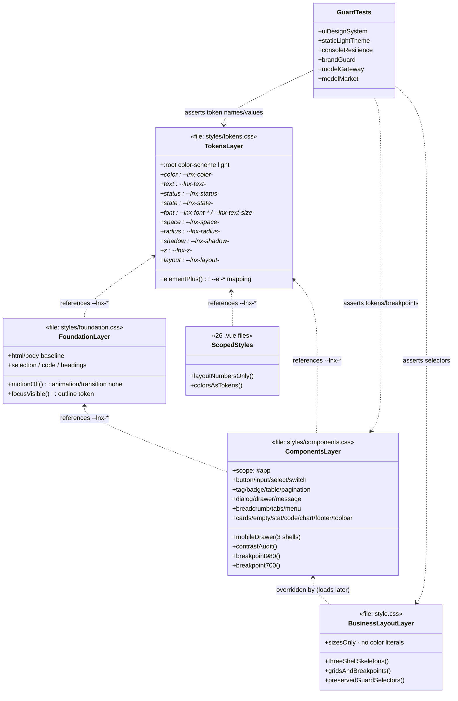
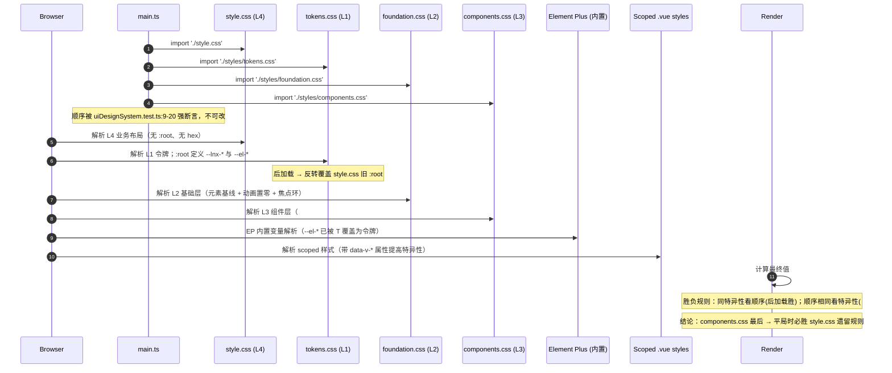
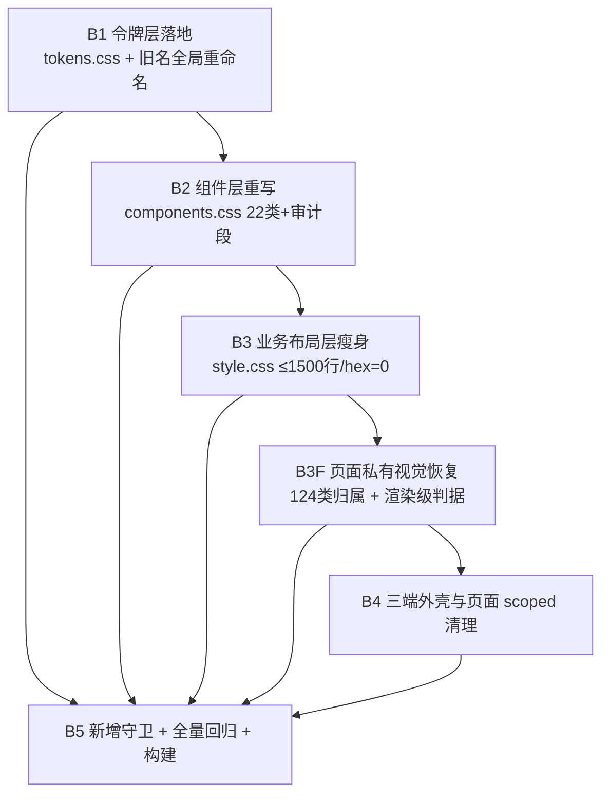

# Linknux 三端样式体系重构 · 架构设计与任务分解

## 0. 文档信息与结论摘要

| 项 | 内容 |
| --- | --- |
| 文档名称 | Linknux 三端样式体系重构 · 架构设计与任务分解 |
| 文档版本 | v1.7（v1.7 修正：B5 的 D-2 断言补三条口径缺口 —— ① **口径从「hex 归零」扩为「`hex` 与 `rgba()` 均只允许出现在 `tokens.css`」**（全仓 `*.css` + 全部 `.vue` 的 `<style>` 块；`foundation.css:27/94`、`components.css:449` 残留 rgba/hex）；② **明确 `<script>` 块处置**：ECharts `option`/调色板 hex 白名单**枚举化**且值须与新品牌一致（`AdminUsageCharts.vue:68`/`UsageTimelineChart.vue:45` 仍用旧 `#1769ff` → B4c 改 `#2563eb`），并**新增断言 `#1769ff` 全仓 = 0**；③ **新增断言「旧命名空间 `var(--tech-*`/`--ui-*`/`--admin-*` 引用 = 0」**（`.css`+`.vue` 的 `<style>`/`<script>`）+ **附录 C 补漏 C-L5**（新类型：无 hex 但引用已废弃命名空间，如 `AdminPageToolbar.vue` 5 处 `var(--admin-*)`）；④ **B4 拆为 B4a/B4b/B4c**（B4c 收跨层残留 5 处）；⑤ 登记**仓库卫生风险**（B1–B4 仅在工区）；⑥ 登记 `AutoMovieStudio`（活组件）/`TechBackdrop`（未挂载）事实核验。v1.6：校正 128 类 / 40 文件 + B4 拆 a/b。v1.5：A1 棘轮、property-baseline 正式裁决不纳入、附录 C 补漏清单、B4 跨批红窗口、D-2 口径。v1.4：B5 升级 A1+A2。v1.3：派生式覆盖守卫。v1.2：§5.1.5 三层归属 + B3F + 原则 3 + 附录 C。v1.1：U-1/U-2/U-3 裁定、批次序调整） |
| 作者 | 高见远（Gao）· 架构师 |
| 上游输入 | `docs/restyle/01-prd-design-system.md`（v1.0，611 行） |
| 实施对象 | `D:/Code/中转站/API_transit_station/web`（前端根，代码在 `web/src`） |
| 技术栈 | Vue 3 + TypeScript + Element Plus + Tailwind CSS + ECharts（Vite 8） |
| 适用范围 | `web/src` 全量样式层；**不改**模板结构、路由表、props 契约、业务逻辑 |
| 目标 | 令牌收敛为唯一 `--lnx-*`；`style.css` 由 6984 行瘦身至 ≤1500 行；**全仓 hex 仅存于 `tokens.css`**（全口径 = `*.css` + 全部 `*.vue` `<style>` 块；白名单**仅** ECharts option 与 Logo SVG，见 §5.1.6）；`!important` 大幅削减 |
| Language | 中文 |

### 0.1 现状实测基线（本次侦察结果，可复现）

| 文件 | 行数 | 硬编码 hex | `!important` |
| --- | --- | --- | --- |
| `src/style.css` | 6984 | **851** | **704** |
| `src/styles/tokens.css` | 74 | 45 | 0 |
| `src/styles/foundation.css` | 111 | 2 | 13 |
| `src/styles/components.css` | 970 | 50 | 132 |
| 页面 scoped 样式（26 个 `.vue`，**v1.6 实测含 hex/rgba/渐变者达 40 个**，见 §5.3 B4） | ~2400 | ~470 | — |

`src/style.css` 内 `:root` 定义分布（**共 5 处**）：

| 行号 | 内容 | 处置 |
| --- | --- | --- |
| `1` | 浅色 `--tech-*` + 一组 `--el-*`（主色 `#1769ff`） | 删除（值迁入 tokens.css） |
| `4364` | **深色 `--tech-*` + `color-scheme: dark`**（死主题） | 删除（随 4359–5772 整段删除） |
| `5778` | 浅色 `--tech-*` + `--el-*`（`color-scheme: light`） | 删除（值迁入 tokens.css） |
| `6219` | `--ui-*`（11 条） | 删除（值迁入 tokens.css 对应新令牌） |
| `6687` | `--admin-*`（9 条） | 删除（值迁入 tokens.css 对应新令牌） |

### 0.2 六项主理人裁定（直接采纳，不再讨论）

| 编号 | 裁定 | 架构落地方式 |
| --- | --- | --- |
| Q-1 | **零别名，一次性收敛** | 全局替换全部 `--tech-*`/`--ui-*`/`--admin-*`/旧 `--lnx-*` 引用后，删除全部旧定义；不保留别名段；新增「旧前缀零出现」守卫 |
| Q-2 | 采纳 §4.5 两条渐变 | `--lnx-gradient-brand` / `--lnx-gradient-page` |
| Q-3 | 采纳 `#f4f7fb` | `--lnx-color-bg: #f4f7fb` 三端唯一底色 |
| Q-4 | 不引入侧栏收起交互 | 仅登记 `--lnx-layout-admin-sidebar-collapsed: 64px`，不写行为 |
| Q-5 | `AdminConsole.vue` 607 行 scoped **就地替换色值** | 不新建 `styles/admin.css`，不改 `main.ts` 导入顺序 |
| Q-6 | `TechBackdrop.vue` 保留文件不挂载 | 文件头加「未挂载遗留组件，保留备用」注释；138 行 scoped hex 机械替换为令牌 |

### 0.3 三项债务（PRD 未覆盖，本文档处理）

| 债务 | 位置 | 处置 | 详见 |
| --- | --- | --- | --- |
| D-a 死深色主题残留 | `style.css:4365` `color-scheme: dark;`，属 `4359–5772` 整段 | **整段删除**（4359–5772，共 1414 行） | §5.2、§5.3 |
| D-b 704 个 `!important` | `style.css` 全文件 | 降级至 **≤40**（白名单见 §5.1.3） | §5.1.3 |
| D-c `.el-button--primary` 定义两遍 | `style.css:197` 与 `style.css:4636` | 合并为 **唯一一处**，落在 `components.css` | §5.1.4 |
| **D-d 页面级私有视觉无归属容器**（v1.2 新增，B3 暴露） | `style.css` 被 B3 删除的 **237 个孤儿类**（其中 **124 个**被模板引用、真实掉色；**另有 4 个漏项**见「附录 C 补漏清单」）。**v1.6**：§4-A 的 4 类（父 `display:none`）经硬判据**一并恢复**，实际断言类 = **128** | 定义 **三层归属规则** 并为 128 类逐个指定恢复容器；新增修正批次 **B3F** | **§5.1.5 / 附录 C（含补漏清单）/ §5.3 B3F** |

### 0.4 关键架构结论（主理人已提出，本文档确认并展开）

> **`style.css` 不能删空**，它固化为**「业务布局层」**：只保留三端骨架、栅格、断点、尺寸类规则（含全部被守卫断言的选择器），颜色一律改为 `var(--lnx-*)` 引用，`hex` 清零、`:root` 令牌定义清零。

已逐条核验「守卫依赖的布局选择器均位于 `style.css` 的非删除区」，删除 4359–5772 深色段**不会**触发任何守卫断言转红（核验明细见 §5.3.2）。此结论是本次重构安全性的基石。

---

# Part A：系统设计

## A1. 实现路径分析

### A1.1 核心技术难点

| 编号 | 难点 | 本质 | 架构对策 |
| --- | --- | --- | --- |
| H-1 | **加载顺序被测试强断言，不可调** | `main.ts` 四行导入顺序 = 层叠顺序；`style.css` 最先、`components.css` 最后 | 不新增样式文件、不改导入顺序；靠「新令牌层后加载 → 反转覆盖旧 `:root`」「components.css 最后加载 → 天然胜出」取胜 |
| H-2 | **具体选择器内的 851 个 hex 靠优先级击穿令牌层** | 令牌层再多，也斗不过 `style.css` 里 `#app .x { background:#fff !important }` | 定点清除：删除死代码段 + 全量 hex→令牌；以「`#app` 作用域 + 最后加载」保证覆盖 |
| H-3 | **守卫测试与旧令牌名强耦合** | 6 个测试文件、约 40 条断言行硬编码旧令牌名/旧色值 | 产出**逐条「旧断言→新断言」替换表**（§6），批次内同步更新，保证每批次结束可验证 |
| H-4 | **`!important` 军备竞赛** | 704 个 `!important` 互相覆盖，令牌层与组件层被击穿 | 见 §5.1.3 治理策略：删死代码 → EP 变量替代 → 白名单兜底 |
| H-5 | **Element Plus 内部结构 + teleport 出 `#app`** | 弹层 teleport 到 `body`，`#app` 作用域失效 | 全局层（非 `#app`）覆盖 `.el-message`/`.el-notification`/`.el-message-box`；用 `--el-*` 变量而非 `!important` |
| H-6 | **3407 行 `AdminConsole.vue` + 607 行 scoped** | 规模大、易漏 | 机械替换（hex→令牌）+ 批次 4 独立回归 |
| H-7 | **表格/图表内联色** | ECharts option 内 hex、EP 表格 `--el-table-*` | ECharts 配置对象 hex 进白名单（PRD D-2）；EP 表格改走 `--el-table-*` 变量 |

### A1.2 框架与库选择（沿用现有栈，本次仅样式层，零新增依赖）

| 关注点 | 选择 | 理由 |
| --- | --- | --- |
| 组件库 | Element Plus（既有） | 不换库；通过 `--el-*` 变量 + `#app` 覆盖统一视觉 |
| 原子化 | Tailwind（既有） | 本次不动 `tailwind.config`（P2-4 才补映射）；仅约束「不得新引入 Tailwind 硬编码色值」 |
| 图表 | ECharts（既有） | 仅收敛序列色到令牌；option 对象内 hex 属白名单 |
| 令牌载体 | 原生 CSS 自定义属性（CSS Custom Properties） | 零运行时、天然继承、可 `getComputedStyle` 取值（满足 B-2） |

### A1.3 架构模式

采用**分层样式架构（Layered Stylesheet Architecture）**，四层单向依赖：

```
L4 业务布局层（style.css）      —— 只放骨架/栅格/断点/尺寸，颜色走令牌
        ▲ 被 L3 覆盖
L3 组件层（components.css）    —— #app 作用域，统一 22 类组件 + 对比度审计
        ▲ 被 L3 覆盖
L2 基础层（foundation.css）    —— 元素基线、焦点环、动画置零
        ▲ 被 L3 覆盖
L1 令牌层（tokens.css）        —— 唯一真源 --lnx-* + --el-* 映射
```

设计原则：**单向依赖、下层不反向引用上层的选择器**，层与层之间只通过令牌通信。

---

## A2. 文件清单

> 路径相对 `D:/Code/中转站/API_transit_station/web`。风险等级：低/中/高 = 回归概率。

### A2.1 样式文件（4 个）

| 路径 | 变更类型 | 预计改动量 | 风险 | 说明 |
| --- | --- | --- | --- | --- |
| `src/styles/tokens.css` | **全量重写** | 74 → 约 220 行 | 中 | 唯一真源：§4.1–4.14 全部令牌 + EP 映射；含 `color-scheme: light` |
| `src/styles/foundation.css` | **局部替换 + 扩充** | 111 → 约 160 行 | 低 | 元素基线；保留 `*,*::before,*::after` 置零与 `.sr-only`；补焦点环令牌化 |
| `src/styles/components.css` | **全量重写** | 970 → 约 1200 行 | 中 | `#app` 作用域 22 类组件 + 「对比度与色彩和谐审计」段 + 980/700 断点 |
| `src/style.css` | **重写（瘦身）** | **6984 → ≤1500 行** | **高** | 业务布局层：删除 4359–5772 死段 + 5 处 `:root` + hex 清零 + `!important` 降级 |

### A2.2 三端外壳与布局（4 个）

| 路径 | 变更类型 | 预计改动量 | 风险 | 说明 |
| --- | --- | --- | --- | --- |
| `src/layouts/PublicLayout.vue` | 局部替换 | 48 行 scoped 内 14 hex → 令牌 | 低 | 保留 `class="site-mobile-drawer"`（A-1 断言） |
| `src/views/UserConsole.vue`（1527 行） | 局部替换 | ~2000 行 scoped 内色值 → 令牌 | 中 | 保留 `class="user-mobile-drawer"`（A-1 断言）；分页契约不动 |
| `src/components/AdminLayout.vue` | 局部替换 | 179 行 scoped 内 21 hex → 令牌 | 中 | `rgba(250,253,255,.98)`、`linear-gradient(135deg,#1769ff,#00a9cc)` 必须终结（consoleResilience:80-81） |
| `src/views/AdminConsole.vue`（3407 行） | 局部替换（就地） | 607 行 scoped 内 60 hex → 令牌 | **高** | 保留 `min-width: 1400px`/`2600px`（consoleResilience:89-90） |

### A2.3 页面 scoped 清理（按 hex 量降序，仅列主要）

| 路径 | hex 数 | 变更类型 | 风险 |
| --- | --- | --- | --- |
| `src/views/CreativeStudio.vue` | 147 | 局部替换 | 中（色量最大） |
| `src/views/AdminConsole.vue` | 60 | 局部替换 | 高（见上） |
| `src/views/ProductItem.vue` | 58 | 局部替换 | 中 |
| `src/components/ModelSalePricing.vue` | 27 | 局部替换 | 低 |
| `src/components/AdminLayout.vue` | 21 | 局部替换 | 中 |
| `src/components/AdminUsageCharts.vue` | 20 | 局部替换 | 低 |
| `src/components/AutoMovieStudio.vue` | 17 | 局部替换 | 低 |
| `src/views/AdminVmCardTest.vue` | 16 | 局部替换 | 低 |
| `src/components/TechBackdrop.vue` | 14 | 局部替换 + 头注释 | 低（未挂载） |
| `src/components/ContactWidget.vue` | 14 | 局部替换 | 低 |
| `src/layouts/PublicLayout.vue` | 14 | 局部替换 | 低 |
| `src/components/ModelProbePanel.vue` | 12 | 局部替换 | 低 |
| `src/components/ModelPriceComparisonDialog.vue` | 12 | 局部替换 | 低 |
| `src/views/AdminSubscriptionServices.vue` | 11 | 局部替换 | 低 |
| 其余 12 个 `.vue`（各 ≤10 hex） | ~120 | 局部替换 | 低 |

### A2.4 守卫测试文件（6 个，**必须同步更新**）

| 路径 | 变更类型 | 风险 | 说明 |
| --- | --- | --- | --- |
| `tests/uiDesignSystem.test.ts` | 局部替换（令牌名） | 中 | 26-30 行令牌名替换 |
| `tests/staticLightTheme.test.ts` | 局部替换 + 重定向扫描目标 | **高** | 16-54 行多条断言重写 |
| `tests/consoleResilience.test.ts` | 局部替换（主按钮色 + 后台调色板） | **高** | 73-74、80-81 行 |
| `tests/brandGuard.test.ts` | **不改** | 低 | A-4 保持 |
| `tests/modelGateway.test.ts` | **不改** | 低 | 布局断言保持在 `style.css` |
| `tests/modelMarket.test.ts` | **不改** | 低 | 布局断言保持在 `style.css` |

### A2.5 新增守卫脚本（批次 B3F / B5，P1）

| 路径 | 变更类型 | 说明 |
| --- | --- | --- |
| `tests/visualRestoreGuard.test.ts` | **新建（B3F）** | 文本级兜底：附录 C 的 **128 个类名逐个**（124 类 + `APPENDIX_C_GAPS` 4）在 `components.css`（不含 `tokens.css`）或对应页面 scoped 中命中 **≥1 条视觉声明**；防「类视觉无承载」再次发生。**注：固定名单守卫只能防守名单内的类，防不住「第 129 个类」——该缺口由下方派生式守卫补齐** |
| `tests/coverageGuard.test.ts` | **新建（B5）** | **派生式覆盖守卫**（不依赖业务名单）：**断言 A1**（任何声明口径，`USED − STYLED_ANY − 白名单`=0，抓「整类样式全丢」）；**断言 A2**（视觉声明口径 + 固化基线，抓「曾有视觉声明的类丢失视觉声明」——A1 的 163 类盲区）；**断言 B** 禁止空规则体（`sel { }`）；**断言 C** 校验样式来源集合闭合（与 `main.ts` 导入顺序一致）。**误报试算：A1 残余 38（白名单 38 条）、A2 残余 1（真阳性）**（见 §B5 试算表） |
| `tests/designSystemGuard.test.ts` | **新建（B5）** | ① **旧命名空间零引用**（`var(--tech-*`/`--ui-*`/`--admin-*`，含 `.vue` `<style>`/`<script>`）；② **`hex` + `rgba()` 归零**（全仓 `*.css` + `.vue` `<style>`；白名单 = 枚举化 5 `<script>` ECharts 文件 + `englishCopy.generated.ts` + Logo `*.svg`）；③ `#1769ff` 零出现（含 `<script>`）；④ `!important` 上限；⑤ `prefers-color-scheme: dark` / `color-scheme: dark` 零出现；⑥ `tokens.css` 含 `color-scheme: light`。v1.7 起 ①②③ 为 B4c 的收口判据 |
| `tests/fixtures/unstyled-hooks.json` | **新建（B5）** | `coverageGuard.test.ts` **A1** 的**可评审白名单**（实测 **38 条**）：登记「确属动态拼接 / 死代码 / EP 消费 / 具名挂点」而无须静态声明的类，每条含 `class` + `reason` + `file`；改动需评审（见 §B5-A1） |
| `tests/fixtures/visual-coverage-baseline.json` | **新建（B5）** | `coverageGuard.test.ts` **A2** 的**固化基线**（实测 **297 条**）：改造前（`git show HEAD:web/src/style.css`）**确有视觉声明**、且非（113 死类 / `el-*` / R12 子元素 / 死父类子元素）的类；每条含 `class` + `reason`（枚举）+ `source`（`HEAD:行号`）。生成算法见 §B5-A2 |

### A2.6 禁止改动的文件（红线）

- `src/main.ts`（导入顺序被 `uiDesignSystem.test.ts:9-20` 强断言）
- `src/App.vue`（不得出现 `<TechBackdrop`，`staticLightTheme.test.ts:11`）
- `src/router/**`、`src/utils/listPage.ts`（分页契约 `DEFAULT_PAGE_SIZE = 10`）
- `src/components/AdminPageToolbar.vue` 的 `name="filters"` / `name="actions"` 插槽
- 任何 `template` 结构、`props`、`<script>` 业务逻辑

---

## A3. 数据结构与接口（类图）



**接口契约（层与层的唯一通信面）**：所有层只允许引用 `--lnx-*` 令牌与 `--el-*`（EP 映射）。任何层**禁止**定义新的 `:root` 令牌、禁止引用 `--tech-*`/`--ui-*`/`--admin-*`、禁止写 hex 字面量（白名单除外）。

---

## A4. 程序调用流程（层叠时序图）



**层叠胜负判据（计算最终值时的确定规则）**：

1. **`!important` 优先**：带 `!important` 者先胜（故需治理，见 §5.1.3）。
2. 同 `!important` 状态 → 比**特异性**：`#app .x`（1,1,0）> `.x`（0,1,0）> `x`（0,0,1）；scoped 注入的 `[data-v-*]` 属性选择器等同 class。
3. 特异性相同 → 比**源顺序**：`main.ts` 后导入者胜 → `components.css` 天然压过 `style.css`。
4. 以上皆同 → 比**作用域**：非 `@media` 内规则参与常规比较；`@media` 命中时其内规则按同一套规则参与。

---

## A5. 待明确事项（UNCLEAR）

见 §8「待明确事项」，共 **3** 项（U-1 主按钮色板语义、U-2 审计段归属、U-3 重复断言），**均已由主理人于 2026-09-29 裁定**：U-1 主按钮改纯色 `var(--lnx-color-brand-600)` + 白字、断言去 `!important`；U-2 采纳方案 A；U-3 删重复并新增深色主题零出现守卫。详见 §8 / §5.1.4 / §6.6。

---

# Part B：任务分解

## B0. 所需包（第三倚依赖）

**零新增依赖**。本次仅样式层重构，沿用现有栈：

```
- vue@^3 (既有)
- element-plus (既有)
- tailwindcss (既有)
- echarts (既有)
- vitest (既有，运行守卫测试)
```

新增守卫脚本若需解析 CSS，可用 Node 内置 `fs` + 正则（**不引入** postcss/css-tree，保持零依赖）。

## B1. 任务批次总览

> 硬约束：**≤5 个批次**（对齐"每批次可独立验证、可独立回滚"）。每批次结束跑对应守卫测试必须**全绿**（批次 1–4 同步更新本次变更所破坏的断言，故全流程无"已知红"窗口）。
>
> **⚠️ 原则 1（批次序，沉淀，v1.1）**：**断言必须与其目标内容同批次迁移；「内容先离开 A 文件、后进入 B 文件」的中间态必须避免。**
> 推论：当某批断言的**目标内容迁入新文件**时（本次为 §6.4 的审计段与 §5.1.4 的主按钮迁入 `components.css`），必须让**新文件所在批次先行**，断言在同批次跟随迁移；随后旧文件的瘦身只删除已被接管的规则，不再触碰任何断言。
> 依此原则，本次顺序为 **组件层（内容迁入）先于 `style.css` 瘦身（内容迁出）**，其后为误删修正与 scoped 清理：`B1 → B2(组件层) → B3(style.css) → B3F(视觉恢复) → B4 → B5`（v1.2 起含 B3F）。
>
> **⚠️ 原则 2（断言与 `!important` 解耦，沉淀，v1.1）**：**测试断言只校验「声明值」，不得把 `!important` 写进断言字符串。** 因 `!important` 清理（B3）横跨 `style.css` 与 `components.css`，断言若绑定 `!important` 则清理必然转红。配套：B2 允许**按需** `!important`（不牺牲视觉正确性），B3 **统一清理两侧**且**不改任何断言**。详见 §5.3。

| 批次 | 标题 | 交付文件 | blockedBy | 完成判据 |
| --- | --- | --- | --- | --- |
| **B1** | 令牌层落地（唯一真源 + 旧名全局重命名 + 断言同步） | `tokens.css`、全仓 `src/**/*.{css,vue}`（旧 `--lnx-*`→新名）、`uiDesignSystem.test.ts:26-30` | `[]` | `npx vitest run tests/uiDesignSystem.test.ts` 全绿；`tokens.css` 无 `--tech-`/`--ui-`/`--admin-`；**旧 `--lnx-*` 名残留 = 0**（判据命令见 §5.3 B1） |
| **B2** | 组件层重写（22 类 + 审计段 + 唯一主按钮） | `components.css`、`staticLightTheme.test.ts`（16-55）、`consoleResilience.test.ts:72-75` | `[B1]` | `components.css` hex=0 且含 980/700 断点；`npx vitest run tests/staticLightTheme.test.ts tests/consoleResilience.test.ts tests/uiDesignSystem.test.ts` 全绿 |
| **B3** | 业务布局层瘦身（`style.css`）+ 两侧 `!important` 清理 | `style.css`、`components.css`（仅 `!important` 清理） | `[B2]` | `style.css` ≤1500 行、hex=0、`:root`=0、`!important`≤40；**全量 `npx vitest run` 全绿** |
| **B3F** | **页面级私有视觉恢复（错删修正，v1.2）** | `docs/restyle/04-restore-declarations.md`（旧值→新令牌施工卡）、`components.css`（**新增**层 A/层 B 规则）、少量页面 `.vue`（层 C scoped）、**新建** `tests/visualRestoreGuard.test.ts` | `[B3]` | 附录 C **124 类**（LAYER_A 69 + LAYER_B 37 + LAYER_C 18）+ **补漏 4 类**（`APPENDIX_C_GAPS`）= **128 类逐个**在 `components.css` 或页面 scoped 命中 ≥1 视觉声明；**§4-A 的 4 类按硬判据一并恢复**（v1.6）；**渲染级**三端代表页抽样 `getComputedStyle` 非退化（见 §5.3 B3F） |
| **B4** | 三端外壳与页面 scoped 清理（**v1.6 拆 B4a/B4b，v1.7 增 B4c**） | **B4a**：`views/`20 + `layouts/`1；**B4b**：`components/`19；**B4c**：跨层残留 5 处（`foundation.css` / `components.css` / `AdminPageToolbar.vue` / `AdminUsageCharts.vue` / `UsageTimelineChart.vue`）；`consoleResilience.test.ts:63-65`、`:80-81` | `[B3, B3F]` | 全口径（`*.css` + `*.vue` `<style>`）**`hex`=0 且 `rgba()`=0**；`#1769ff`=0；`var(--tech-*/--ui-*/--admin-*)`=0；`consoleResilience` / `brandGuard` / `staticLightTheme` 全绿 |
| **B5** | 新增守卫（固定名单 + **派生式覆盖 A1/A2**）+ 全量回归 + 构建 | `tests/designSystemGuard.test.ts`、**`tests/coverageGuard.test.ts`**、**`tests/fixtures/unstyled-hooks.json`**、**`tests/fixtures/visual-coverage-baseline.json`**、无源码改动 | `[B1, B2, B3, B3F, B4]` | `designSystemGuard` 全绿；**`coverageGuard`：A1 offenders 全在白名单内、A2 offenders=0、断言 B 空规则=0、断言 C 来源集合一致**；`npm run test` + `npm run build` 通过 |

**回滚单元**：每批次 = 一个 git 提交单元。回滚 B4 不影响 B1–B3F；回滚 B2（组件层）需**同时回滚 B3/B3F**（`style.css` 瘦身删除了旧主按钮/审计规则，其替代定义由 B2 落于 `components.css`，且 B3/B3F 依赖 B2 已接管视觉）；**回滚 B3F 不影响 B4 之外任何批次**（B3F 只新增视觉规则、不改断言、不改 `style.css`）。

---

## 5.1 样式分层架构

### 5.1.1 四文件 + scoped 职责边界表

| 文件 | 只允许放什么 | 禁止放什么 |
| --- | --- | --- |
| `styles/tokens.css`（L1） | ① `:root` 唯一令牌定义（`--lnx-*` 全量）② `--el-*` 映射块 ③ `color-scheme: light` ④ 文档注释 | ❌ 任何具体选择器（`.x{}`）❌ 任何 hex 以外用途的字面色 ❌ `!important` |
| `styles/foundation.css`（L2） | ① `html/body/#app` 基线 ② 全局动效置零（`*,*::before,*::after`）③ `:focus-visible` 焦点环 ④ `::selection`/标题/正文/代码排版 ⑤ `.sr-only` ⑥ 页面内容宽度与 680px 边距 | ❌ 组件类选择器（`.el-button` 等）❌ `:root` 令牌定义 ❌ 业务页面选择器 |
| `styles/components.css`（L3） | ① `#app` 作用域下 22 类共享组件规则 ② 三端移动抽屉（3 类名）③ 980/700 断点 ④ **「对比度与色彩和谐审计」段**（`#app` 作用域的最终前景/背景保障，允许引用业务页选择器）⑤ 非 `#app` 的 teleport 浮层规则（`.el-message`/`.el-notification`/`.el-message-box`）⑥ **主按钮为纯色** `var(--lnx-color-brand-600)`，渐变仅用于 Hero/CTA 面 | ❌ `:root` 令牌定义 ❌ 页面栅格/断点骨架（归 L4）❌ 新增 hex（白名单外）❌ 主按钮使用渐变（会破坏 B-2 计算样式校验） |
| `style.css`（L4，业务布局层） | ① 三端外壳骨架（`.public-site`/`.user-console`/`.admin-shell` 布局）② 栅格（`.playground-layout`/`.market-grid`/`.market-catalog-shell` …）③ 断点与尺寸类 ④ **全部被守卫断言的布局选择器** ⑤ 颜色一律 `var(--lnx-*)` | ❌ 任何 `:root` 块 ❌ 任何 hex 字面量 ❌ `--tech-*`/`--ui-*`/`--admin-*` ❌ 任何 `--lnx-*` 定义 ❌ 组件视觉（归 L3） |
| 页面 `scoped` 样式（.vue） | ① 页面本地布局数值（grid/flex/padding/width）② 颜色一律 `var(--lnx-*)` 引用 | ❌ hex 字面量（白名单外）❌ 令牌定义 ❌ 跨页面覆盖 |

> **边界例外（唯一）**：L3「对比度与色彩和谐审计段」允许引用业务页选择器（如 `#app .market-guide`）。理由：其职责是"最终保障"，需与 `staticLightTheme.test.ts:24` 的字面量注释 `Contrast and color harmony audit` 同处一文件，且必须最后加载才能赢。此例外在 §6.4 有对应断言重定向。

> **「页面级私有视觉」的归属（v1.2 补，见 §5.1.5）**：上表给出「层」的职责，但**未回答「页面级私有视觉最终归哪个容器」**。B3 暴露的缺口（D-d）由 **§5.1.5 三层归属规则（层 A 共享区 / 层 B 审计段 / 层 C 页面 scoped）+ teleport 例外** 补齐；124 个被 B3 误删的类按 §5.1.5 规则经 **B3F** 批次恢复（逐类见附录 C）。

### 5.1.2 优先级／层叠策略（**不改 `main.ts` 导入顺序**）

| 目标 | 手段 | 说明 |
| --- | --- | --- |
| 新令牌覆盖 `style.css` 旧 `:root` | 落 `tokens.css`（在 `style.css` 之后加载） | 旧 `:root` 全部删除，双保险 |
| 新组件层覆盖 `style.css` 遗留规则 | `components.css` 最后加载；平局时必胜 | 见 A4 时序图判据 3 |
| 击穿 `style.css` 内具体选择器的遗留覆盖 | ① 删除死段 ② hex→令牌 ③ 需要时用 `#app` 前缀提特异性 | `#app .x`（1,1,0）稳定压制裸 `.x` |
| `#app` 作用域前缀用法 | 组件层与审计段统一以 `#app` 开头 | 与 EP 的 `body` 级浮层区分；teleport 浮层用全局选择器 |
| scoped 样式与全局冲突消解 | ① scoped 只写布局数值 ② 颜色全部走令牌 ③ 若需覆盖 EP 内部，用 `:deep()` 且**避免 `!important`** | scoped 的 `[data-v-*]` 已提供一层特异性 |
| 禁止 | ❌ 新增 `styles/*.css` 文件 ❌ 改 `main.ts` ❌ 新增 `@layer`（会改变层叠语义，风险高） | — |

### 5.1.3 `!important` 治理策略

**目标上限**：

| 文件 | 现状 | 目标 | 理由 |
| --- | --- | --- | --- |
| `style.css` | 704 | **≤ 40** | 业务布局层几乎无需；仅保留 EP teleport/flex 兜底 |
| `components.css` | 132 | **≤ 50** | 组件层需少量压制 EP 默认 |
| `foundation.css` | 13 | **13（不变）** | 无障碍基线：动效置零 + `.sr-only` |
| `tokens.css` | 0 | **0** | 令牌层禁用 |

**`!important` 白名单（必须保留的类别）**：

| # | 类别 | 选择器示例 | 为何必须保留 |
| --- | --- | --- | --- |
| W1 | 全局动效置零 | `*, *::before, *::after { animation/transition/scroll-behavior: none !important }` | 压制 EP 内置 keyframes；被 A-6 / `uiDesignSystem:33-34` 断言 |
| W2 | 无障碍隐藏 | `.sr-only { … !important }` | 视觉隐藏需压过组件样式 |
| W3 | EP 弹层视口钳制 | `.el-dialog { max-width / margin }`、`.el-drawer { max-width/max-height }` | EP 用内联 `width`，非 `!important` 压不住 |
| W4 | teleport 浮层（出 `#app`） | `.el-message`、`.el-notification`、`.el-message-box` | 无 `#app` 作用域可用，靠 `!important` 兜底 |
| W5 | 表格表头/单元格背景兜底 | `#app .el-table th.el-table__cell { background }` | **降级优先级**：优先改用 `--el-table-header-bg-color` 变量；仅当变量不足以覆盖时保留 |

> **主按钮不在白名单内（重要）**：`#app .el-button--primary:not(.is-link):not(.is-plain):not(.is-text)` 特异性 = (1,2,0)，已足以压过 Element Plus 的 `.el-button--primary` (0,1,0)，且 `components.css` 最后加载。因此主按钮**优先不带 `!important` 落地**；若 QA 阶段实测 EP 压不住，再局部加回 `!important` **并同步改写** `consoleResilience.test.ts:73-74` 断言字符串，同时把该例外登记到 §5.6 回归风险表。**不得**因主按钮向白名单新增 W 条目。

> **与断言解耦（原则 2）**：断言只校验「声明值」，不校验 `!important` 的有无；`!important` 的清理由 B3 统一在 `style.css` + `components.css` 两侧执行，且不得改动任何断言字符串。详见 §5.3 原则 2。

**分阶段削减顺序（逐段执行，每段后跑测试）**：

| 序 | 动作 | 预计削减 |
| --- | --- | --- |
| 1 | 删除死深色段 `4359–5772` | ≈ −316 |
| 2 | 删除 5 处 `:root` 与重复 body/根选择器 | ≈ −10 |
| 3 | 用 `--el-*` 变量替代 EP 组件的 `background/color/border !important` | ≈ −180 |
| 4 | 组件视觉迁入 `components.css` 并用 `#app` 提特异性，去 `!important` | ≈ −120 |
| 5 | 合并 `.el-button--primary`（197/4636）与其它同文件重复定义 | ≈ −40 |
| 6 | 残留白名单收敛 | 收敛至 ≤40 |

### 5.1.4 重复 `.el-button--primary` 合并方案

**现状**（同文件自相冲突）：

| 位置 | 内容 | 冲突点 |
| --- | --- | --- |
| `style.css:197-222` | 浅色主按钮：`background:#e2efff !important; color:#0d4f9f !important` | 与 4636 争夺 |
| `style.css:4636-4650` | 又一套 `.el-button--primary:not(.is-link):not(.is-plain):not(.is-text)` | 同特异性、后加载者胜（4636 胜） |
| `style.css:4997-4999`、`6746-6755`、`6903-6912` | `#app` 变体（login submit / admin shell） | `#app` 特异性更高，进一步覆盖 |

**合并目标**：**全仓仅保留一处**基础主按钮定义，落在 `styles/components.css`，签名与落地固定为：

```css
/* 唯一基础定义（主按钮纯色，满足 B-2 计算样式校验；优先不带 !important） */
#app .el-button--primary:not(.is-link):not(.is-plain):not(.is-text) {
  background-color: var(--lnx-color-brand-600);   /* #2563eb → B-2 取 background-color = rgb(37,99,235) */
  color: var(--lnx-text-on-brand);                /* #ffffff，于 brand-600 上 5.17:1 ✅AA */
  box-shadow: var(--lnx-shadow-brand);
}
#app .el-button--primary:not(.is-link):not(.is-plain):not(.is-text):hover,
#app .el-button--primary:not(.is-link):not(.is-plain):not(.is-text):focus-visible {
  background-color: var(--lnx-color-brand-700);   /* #1d4ed8 */
}
#app .el-button--primary:not(.is-link):not(.is-plain):not(.is-text):active {
  background-color: var(--lnx-color-brand-800);   /* #1e40af */
}
```

> **为何是纯色而非渐变（主理人 2026-09-29 裁定，修正 v1.0）**：B-2 是 `getComputedStyle` **计算样式断言**，要求主按钮品牌主色 === `rgb(37, 99, 235)`。若 `background` 写渐变，则 `background-color` 为 `rgba(0,0,0,0)`（透明），断言取 `background-color` 会拿到透明 → B-2 直接失败。故主按钮**必须纯色**；`--lnx-gradient-brand` **仅用于 Hero 品牌面与官网大 CTA 区块背景**，不得用于任何 `el-button--primary`。此裁定同时消除 PRD §6.1（"主按钮用渐变"）与 B-2（"主色为纯品牌色"）的内部矛盾。

**语义保护（不丢失 `consoleResilience.test.ts:70-76` 已表达的意图）**：

| 原测试语义 | 新落地 | 断言更新 |
| --- | --- | --- |
| 存在 `.el-button--primary:not(.is-link):not(.is-plain):not(.is-text)` 变体限定 | 保留同签名 | 断言字符串不变，改读 `components.css` |
| 「一个高对比度主按钮样式」 | `background: var(--lnx-color-brand-600);` + `color: var(--lnx-text-on-brand);`（白字于 `brand-600` 5.17:1 ✅），**不带 `!important`** | `73-74` 改为纯色令牌字符串（去 `!important`） |
| 「不影响 link/plain/text 变体」 | 依赖 `:not(.is-link):not(.is-plain):not(.is-text)`；`is-link`/`is-plain` 由独立规则处理 | 新增负向断言：`components.css` 不得对 `is-link`/`is-plain` 使用同一背景令牌 |
| 无页面级 `.market-page .el-button--primary` | 保持无 | `75` 负向断言不变 |

> ✅ **U-1 已裁定（主理人 2026-09-29）**：主按钮由「浅色底(`#e2efff`/`#0d4f9f`)」与「渐变+白字」二选一的争议，最终定为**纯色 `var(--lnx-color-brand-600)` + 白字 `var(--lnx-text-on-brand)`**，保证 B-2 计算样式可校验、后台密集场景更克制、并消除 PRD 内部矛盾。实现优先不带 `!important`。详见 §8 U-1。

### 5.1.5 页面级私有视觉的归属（三层归属规则 + teleport 例外）

> **本节的由来（B3 教训，设计缺陷而非执行错误）**：B3 使 `style.css` 6985 → **1104 行**、hex=0、`:root`=0，且**全部守卫测试通过**；但仍造成 **237 个类视觉声明整体消失**，其中 **124 个被模板引用、出现真实掉色**（完整清单见 `docs/restyle/03-b3-visual-loss-report.md`）。
>
> **根因**：B1–B3 的架构**只定义了「层」（L1–L4 + scoped），没有为「页面级私有视觉」指定归属容器**。B3 删除了 `style.css` 中大量属于页面/半共享的视觉规则，却没有任何层被指定为它们的**接管方**。守卫测试只断言「**布局选择器字符串**是否存在」，**验不到「某个类的视觉声明是否仍被某一层承载」**——于是「数字达标」与「视觉损失」同步发生。
>
> **判定**：这是一个**架构缺口**（D-d）。本节为「页面级私有视觉」定义**三层归属规则**，并给出 **teleport 例外** 与 **124 类的逐类归属决策表**（附录 C）。**规则：任何被删除的视觉规则，必须命中且仅命中三层中的一层。**

#### （1）三层归属规则（核心）

| 层 | 容器（文件） | 作用域前缀 | **收什么** | **不收什么** |
| --- | --- | --- | --- | --- |
| **层 A · 共享组件层** | `src/styles/components.css` **共享区** | `#app`（teleport 例外见（2）） | ① **多成员选择器族的成员**（同一条规则里列出 ≥2 个 class，如「卡片面族」「代码块族」「标题族」「tone 色族」）；② **被 ≥2 个模板文件引用**的类；③ 三端外壳公共部件（品牌标、移动抽屉等） | 仅单页使用且不属任何共享族的类 |
| **层 B · 页面审计层** | `src/styles/components.css` **审计段**（`Contrast and color harmony audit`） | `#app`（**允许引用业务页选择器**，见 §5.1.1 唯一例外） | 仅**单页**使用、但需**覆盖 Element Plus 默认 / 跨文件遗留规则**、必须「**最后加载必胜**」的视觉（后台壳、用户台壳的本地修正） | 已被层 A 收编的跨页复用类 |
| **层 C · 页面本地层** | 该页 `.vue` 的 `<style scoped>` | `[data-v-*]`（属性匹配） | 仅**单页**使用、且为**纯本地布局/装饰微调**（grid/flex/padding/宽高/装饰伪元素），**无跨页一致性诉求** | 跨页一致性视觉；任何 hex 字面量（颜色一律 `var(--lnx-*)`） |

**三条规则的判定顺序（短路）**：

1. 类被 **≥2 个模板文件**引用，**或**其丢失声明出自**多成员选择器族** → **层 A**。
2. 否则若该类的视觉需**压过 EP 默认或跨文件遗留**（即「不最后加载就不生效」）→ **层 B**。
3. 否则（单页、单成员、纯本地布局/装饰）→ **层 C**。

> **判据说明**：「多成员选择器族」指改造前 `style.css` 中该 class 与其它 class **同处一条规则**（如 `.panel, .console-panel, …, .el-card { background: … }`）。此类族的**其它成员已落 `components.css`**（B2 已收编 `.panel`/`.el-card` 等），若单独把丢失成员留在 `style.css` 或页面 scoped，会**破坏族内一致性**——故必须回到层 A 的**同一族**。

#### （2）teleport 例外（**覆盖层 A/B 的 `#app` 前缀**）

**问题**：`#app .foo` 依赖 **后代组合子**，要求 `.foo` 位于 `#app` 子树内。但 Element Plus 的 `el-dialog`/`el-drawer`/`el-popover`/`el-message` 默认 **teleport 到 `body`**（`appendTo`/`append-to-body`），元素**脱离 `#app` 子树** → `#app .foo` **失配**，规则不生效。

| 处置 | 做法 |
| --- | --- |
| **teleport 命中类** | 层 A/B 的规则**去掉 `#app` 前缀**，改写为**全局选择器**（`.<class>`）落 `components.css`；**或**落**层 C** 页面 scoped（scoped 靠 `[data-v-*]` **属性**匹配，与 DOM 位置无关，teleport 后仍命中）。 |
| **双位置命中类**（同一页内既在 `#app` 子树、又在 teleport 抽屉） | **必须用全局选择器**（同时覆盖两处），不可用 `#app` 前缀。 |

**teleport 命中排除清单（7 类，逐条已核验模板行号）**：

| 类 | 归属文件 | teleport 证据（文件:行） | 处置 |
| --- | --- | --- | --- |
| `.created-key-secret` | `UserConsole.vue` | 位于 `<el-dialog v-model="createdKeyVisible">` 内（模板 `UserConsole.vue:724`，对话框 `710–731`，默认 teleport） | 层 B/C，**去 `#app`** 或落 scoped |
| `.test-io` | `AdminConsole.vue` | 位于 `<el-dialog v-model="testVisible">` 内（`AdminConsole.vue:746`，对话框 `703–759`） | 层 A code 族，**去 `#app`** |
| `.test-result-panel` | `AdminConsole.vue` | 同 `testVisible` 对话框内（`AdminConsole.vue:732`） | 层 A 卡片面族，**去 `#app`** |
| `.test-result-grid` | `AdminConsole.vue` | 同 `testVisible` 对话框内（`AdminConsole.vue:737`） | 层 B，**去 `#app`** |
| `.market-filter-group` | `ModelMarket.vue` | **双位置**：主面板（`ModelMarket.vue:40`，在 `#app` 内）**与** teleport 抽屉（`:53`，`<el-drawer>` `52–64`） | 层 A，**全局选择器**（覆盖两处） |
| `.market-filter-options` | `ModelMarket.vue` | **双位置**：主面板（`:42`）**与** teleport 抽屉（`:55`） | 层 A，**全局选择器** |
| `.price-hint` | `AdminOtherServices.vue` | 位于 `<el-dialog v-model="dialogVisible">` 内（`AdminOtherServices.vue:179/183`，对话框 `87–233`） | 层 A muted 族，**去 `#app`** |
| `.console-brand` / `.site-brand-mark` / `.brand-image` | `UserConsole.vue`、`PublicLayout.vue`、`AgentConsole.vue` | **双位置/多文件**：`UserConsole.vue:16-17`（主侧栏，`#app` 内）**与** `:58-59`（`append-to-body` 抽屉 `47–84`，`el-drawer`+`append-to-body`）；另见 `PublicLayout.vue:6/36`、`AgentConsole.vue:4` | 层 A，**全局选择器**（跨三端 + 覆盖 teleport 抽屉） |

> 注：上表 `.console-brand`/`.site-brand-mark`/`.brand-image` 三者为**同一品牌标部件**，一行列出。**净 7 项 teleport 命中**。

> **未命中 teleport 的已核验类**（在主模板内，`#app` 前缀有效，无需去前缀）：`AdminConsole` 的 `.channel-ledger-title`(`:397`)/`.channel-ledger-table`(`:405`)/`.model-filter-bar`(`:320`)/`.module-error-state`(`:65…259`)/`.tag-row`(`:304`)/`.tone-green`(`:249`)/`.tone-orange`(`:250`)；`ModelMarket` 的 `.market-filter-panel`/`.market-filter-icon`（主面板，非抽屉）；`UserConsole` 的 `.playground-*`/`.console-status-note`/`.account-summary-grid` 等（主模板）；`HomePage`/`FlowScreen`/`DocsPage`/`PricingPage`/`ProductItem`/`AgentConsole`/`OrganizationConsole` **无 teleport 浮层**。

#### （3）恢复口径（施工准则，供 B3F 执行）

| 层 | 恢复动作 | 颜色处理 |
| --- | --- | --- |
| 层 A | 追加到 `components.css` **同一语义族**规则组（族名见附录 C「族/要点」列）；teleport 命中者改全局选择器 | 一律 `var(--lnx-*)`，**禁止 hex** |
| 层 B | 追加到 `components.css` **审计段**，`#app` 前缀（teleport 命中者去前缀） | 一律 `var(--lnx-*)` |
| 层 C | 追加到对应 `.vue` `<style scoped>` | 布局数值 + `var(--lnx-*)` |

> **硬约束**：恢复**只新增视觉声明**，**不引入 hex**（保持 B5 白名单扫描通过）、**不改模板/`<script>`**、**不改 `main.ts` 导入顺序**、**不触碰任何守卫断言**（被恢复的 124 类**均非**守卫断言目标，故不产生红窗口）。

#### （4）为何这样归属（防再次回归）

守卫测试**验不到「类视觉是否被承载」**，故 B3F 的判据**必须包含渲染级验证**（见 §5.3 B3F「渲染级判据」）。归属规则 + 渲染级判据 = 把「数字达标」升级为「视觉达标」。

---

### 5.1.6 硬编码 hex 处理策略与白名单

| 场景 | 处理 |
| --- | --- |
| `style.css` / `components.css` / `foundation.css` 选择器内 hex / `rgba()` | **全部替换**为 `var(--lnx-*)` / `--lnx-state-*` / `color-mix()` |
| `.vue` **`<style>` 块内 hex / `rgba()`** | **全部替换**为令牌（**B4 主战场**，见下「验收口径」） |
| `tokens.css` | **唯一**允许 `hex` / `rgba()` 的样式文件 |
| **`.vue` `<script>` 块内 ECharts `option`/调色板颜色字面量** | **白名单保留**（枚举见下），但**值须与新品牌一致**（禁止旧 `#1769ff` 等） |
| **`i18n/englishCopy.generated.ts`**（自动生成） | **白名单保留** |
| 品牌 Logo SVG（`*.svg` 或内联 `<svg fill="#…">`） | **白名单保留**（PRD D-2） |

> **验收口径（v1.7 扩，对齐 PRD D-2）**：`styles` 需「归零」的模式 = **`hex` 与 `rgba()` 两者**；扫描范围 = **全仓 `*.css` + 全部 `.vue` 的 `<style>` 块**；`src/styles/tokens.css` 为**唯一**允许 `hex`/`rgba()` 的样式文件。**`<script>` 块不纳入「归零」**（ECharts 需颜色字面量），但纳入下方两条**独立断言**（旧品牌色 / 旧命名空间）。

**白名单（v1.7 枚举化，取代「ECharts 配置对象」的模糊表述）**：允许出现 `hex` 的**非-`tokens.css` 位置**仅限 ——
1. `.vue` `<script>` 内 ECharts 颜色字面量，**限定文件**：`components/AdminUsageCharts.vue`、`components/UsageTimelineChart.vue`、`views/AdminConsole.vue`、`views/UserConsole.vue`、`views/ModelGateway.vue`（实测 `<script>` hex：14 / 8 / 5 / 5 / 3 = **35**）；
2. `i18n/englishCopy.generated.ts`（自动生成）；
3. Logo `*.svg`（或内联 `<svg fill="#…">`）。
**白名单内 hex 的取值也必须与新品牌一致**（见下方断言 ⑫）。

**守卫规则（B5）**：
- `styles-zero`：`全仓 *.css + 全部 .vue <style> 块` 命中 `hex` **或** `rgba()` 即失败，排除 `src/styles/tokens.css`（v1.7：**同时扫两个模式**）。
- `brand-hex-zero`：`#1769ff`（旧 `--tech-*` 主色）**全仓 = 0**（含 `<script>`）。
- `legacy-namespace-zero`：`var(--tech-*` / `var(--ui-*` / `var(--admin-*` 引用**全仓 = 0**（`.css` + `.vue` 的 `<style>` 与 `<script>` 均扫）。

> **⚠️ 现状缺口（v1.7 实测，交由 B4c 收口）**：① **rgba() 漏闸** —— `foundation.css:27` `rgba(37,99,235,.26)`、`foundation.css:94` `#9aabc0 #edf2f7`、`components.css:449` `rgba(15,23,42,.45)`（旧口径只闸 hex，故此前未转红）；② **`<script>` 旧品牌色** —— 5 文件 35 hex，其中 `AdminUsageCharts.vue:68`、`UsageTimelineChart.vue:45` 仍用旧 `#1769ff`；③ **无 hex 但引用废弃命名空间** —— `AdminPageToolbar.vue` 5 处 `var(--admin-*)`（hex 扫描看不见）。以上均由 **B4c** 修正（见 §5.3 B4c）。

---

## 5.2 文件清单与变更规模

见 A2。汇总：**重写 2 个样式文件**（`tokens.css`、`components.css`）、**重写瘦身 1 个**（`style.css`）、**局部替换 1 个 + 30 个 `.vue`**、**更新 3 个测试**、**新建 2 个测试文件 + 2 个 fixture**（B3F `visualRestoreGuard.test.ts`；B5 `coverageGuard.test.ts`、`designSystemGuard.test.ts`；fixture：`unstyled-hooks.json`、`visual-coverage-baseline.json`）；另 **B3F 追加** `components.css` 层 A/层 B 恢复规则与少量页面 scoped，并消除 `style.css` 2 条空规则（v1.2）；**B5 追加派生式覆盖守卫 A1/A2（v1.4）**。**B4（v1.6/v1.7）覆盖 40 个 `.vue`**（`views/`20 + `layouts/`1 + `components/`19），拆 **B4a/B4b/B4c**，权威文件表见 §5.3 B4；另收口跨层残留 5 处（`rgba()`/旧 `#1769ff`/旧 `var(--admin-*)`）。

**`style.css` 分区块处置表**（这是本批次最大的风险面，逐段给出处置）：

| 行范围 | 区块 | 处置 |
| --- | --- | --- |
| `1-29` | `:root` 浅色 tech | **删除**（值迁 tokens.css） |
| `31-151` | viewport 兜底 + dialog/drawer/table 响应式钳制 | **保留结构**，色值→令牌，`!important` 仅留 W3 类 |
| `153-4357` | 亮色皮肤 + 首页概念 + 组件补丁（含 `.playground-layout` 2004、700-1099 媒体 3144、`.market-grid` 2664、`.market-catalog-shell` 2434、`.console-status-note.is-green` 1956、`.site-nav width:100%` 1005、`.user-console` 1541/3216） | **保留被断言布局**，清 hex，去 `!important`，迁视觉规则到 L3 |
| **`4359-5772`** | **深色主题整段（含 `:root`@4364 `color-scheme:dark`、body@4401、4750/4798/4845/4891 各段）** | **整段删除** |
| `5773-6217` | 静态浅色 `:root`@5778 + 动效置零@5819 + `#app` 兜底 | `:root` **删除**；动效置零仅保留于 `foundation.css`；`#app` 兜底迁 L3 |
| `6218-6605` | `:root` `--ui-*`@6219 + 对比度审计 + EP 浮层 | `:root` **删除**；审计段**迁 L3**；浮层规则迁 L3 |
| `6606-6984` | `--admin-*`@6687 + 后台/其它服务/市场工具条 | `:root` **删除**；规则色值→令牌，命题选择器迁 L3 |

### 5.2.1 删除 4359–5772 的安全性核验（**关键**）

逐条核验守卫依赖的布局选择器**均不在** `4359–5772` 区间内：

| 守卫断言 | 目标选择器出现行 | 是否在删除区 |
| --- | --- | --- |
| `consoleResilience:46` `.playground-layout repeat(3…)` | 2004 | ❌ 否（<4359） |
| `consoleResilience:63` `@media (min-width:700px) and (max-width:1099px)` | 3144 | ❌ 否 |
| `consoleResilience:64` `80px minmax(0,1fr)` | 3146 | ❌ 否 |
| `consoleResilience:65` `@media (max-width:700px) .user-console{…minmax(0,1fr)}` | 3216-3218 | ❌ 否 |
| `consoleResilience:66` `.console-status-note.is-green` | 1956 | ❌ 否 |
| `modelGateway:19` `.market-pagination` | 118/122/130/134/2980/3007（4781 在删除区，但其它保留） | ✅ 保留 |
| `modelGateway:20` `.site-nav { width:100%` | 1005-1009 | ❌ 否 |
| `modelGateway:36` `.market-grid repeat(2…)` | 2664 | ❌ 否 |
| `modelGateway:37` `@media(max-width:980px) .market-grid{minmax(0,1fr)}` | 3387 | ❌ 否 |
| `modelMarket:43` `.market-catalog-shell{align-items:stretch}` | 2434 | ❌ 否 |
| `modelMarket:44` `.market-card-details[open] .market-details-open` | 2935 | ❌ 否 |
| `consoleResilience:89-90` `min-width:1400px/2600px` | `AdminConsole.vue` 2895/2900 | ❌ 否（非本文件） |

**结论**：删除 `4359–5772` **不触发任何守卫断言转红**。删除区内 `4781`（`.market-pagination{color}`）与 `4892-4893`（`.market-catalog-shell,.market-grid{background:transparent}`）仅涉颜色属性，其守卫断言所需的选择器字符串在其它行已存在。

---

## 5.3 任务分解（核心交付物）

> **原则 1（批次序，v1.1）**：**断言必须与其目标内容同批次迁移；「内容先离开 A 文件、后进入 B 文件」的中间态必须避免。** 本次 `staticLightTheme` 的大部分断言与 `consoleResilience:72-75` 的目标内容都**迁入** `components.css`，因此 **组件层批次（B2）必须先于 `style.css` 瘦身批次（B3）**：B2 让 `components.css` 就位并同步迁移断言（B2 结束时全量测试即绿），B3 再删除已被接管的旧规则、不再触碰任何断言。
>
> **原则 2（断言与 `!important` 解耦，v1.1）**：**测试断言只校验「声明值」，不得校验 `!important` 的有无。** 断言应写成 `toMatch(/background:\s*var\(--lnx-color-surface\)/)`，或用**不含 `!important`** 的子串做 `toContain`；**禁止**把 `!important` 写进断言字符串。
> **理由**：`!important` 的清理（B3）横跨 `style.css` 与 `components.css` 两个文件；若断言绑定了 `!important`，清理时断言必然变红，而 B3 应当只做清理、不改断言。把「声明的值」与「优先级手段」解耦后，B3 才能在不触碰断言的前提下安全清理 `!important`。
> **配套**：B2 阶段允许在与 `style.css` 遗留规则冲突处**按需使用** `!important`（**不得**为清 `!important` 而牺牲视觉正确性）；B3 统一清理两侧 `!important`。
>
> **⚠️ 原则 3（删除必有接管方 / 视觉归属守恒，沉淀，v1.2）**：**任何从任一文件删除的「视觉声明」，必须在同一批次内被三层归属之一（层 A `components.css` 共享区 / 层 B `components.css` 审计段 / 层 C 页面 scoped，见 §5.1.5）显式接管；不得存在「删除即无接管」的中间态。**
> **理由**：B3 使 `style.css` 达标（≤1500 行、hex=0）且全守卫测试通过，却使 **237 个类**视觉声明整体消失（124 个被模板引用）。根因是守卫**只断言布局选择器字符串存在**，无法察觉「某个类的视觉声明是否仍被某层承载」。B3 删除的视觉规则**没有指定接管方**，故数字达标与视觉损失同时发生。
> **配套**：① 删除前必须对照 §5.1.5 三层规则为每个被删视觉类**标注归属容器**（逐类见附录 C）；② 改造期新增**渲染级判据**（见 B3F），把「数字达标」升级为「视觉达标」；③ 本原则同时约束 **B4**（scoped 清理）与后续所有批次。

### B1 — 令牌层落地（唯一真源 + 旧名全局重命名 + 断言同步）

| 项 | 内容 |
| --- | --- |
| **目标** | 建立唯一 `--lnx-*` 令牌真源，并**同时**把全仓旧 `--lnx-*` 引用一次性改名，避免应用取到未定义变量（颜色回退 inherit）的破窗 |
| **涉及文件** | `src/styles/tokens.css`（全量重写）；**全仓 `src/**/*.{css,vue}`**（旧 `--lnx-*` 名 → 新名，按 §5.4.2 映射表）；`tests/uiDesignSystem.test.ts:26-30`（仅此 5 条，只引用 `tokens.css`，同批成立） |
| **依赖** | 无（`blockedBy: []`） |
| **具体动作** | ① 按 §4.1–4.13 写全 `--lnx-*`；② 写 §4.14 `--el-*` 映射块；③ `:root` 顶部保留 `color-scheme: light`；④ 更新 `tests/uiDesignSystem.test.ts:26-30` 的 5 条令牌名（§6.2 表）；⑤ **跨 `src/**/*.{css,vue}` 全局机械替换旧 `--lnx-*` 名 → 新 `--lnx-*` 名**（`--lnx-brand-*` / `--lnx-cyan-*` / `--lnx-bg` / `--lnx-surface*` / `--lnx-line*` / `--lnx-text*` / `--lnx-success*` / `--lnx-warning*` / `--lnx-danger*` / `--lnx-info*` / `--lnx-radius-control` / `--lnx-radius-card` / `--lnx-shadow-card*` / `--lnx-shadow-overlay` / `--lnx-focus-ring` / `--lnx-content-width` / `--lnx-*-sidebar` / `--lnx-*-gradient`，逐一按 §5.4.2 映射表；**注意词边界**，避免 `--lnx-text` 误伤 `--lnx-text-*` 前缀族） |
| **完成判据** | `npx vitest run tests/uiDesignSystem.test.ts` 全绿；`grep -c '\-\-tech\-\|--ui-\|--admin-' src/styles/tokens.css` = 0；**旧 `--lnx-*` 名残留 = 0**：`grep -rE 'var\(--lnx-(brand\|cyan\|bg\|surface\|line\|text\|success\|warning\|danger\|info\|radius-control\|radius-card\|shadow-card\|focus-ring\|content-width\|user-sidebar\|admin-sidebar)[^-a-z]' src/ \| wc -l` = 0 |
| **风险** | 中。① 令牌名拼写错误 → B5 `getComputedStyle` 冒烟兜底；② 全局重命名误伤 `--lnx-text` 前缀族 → 词边界 + 重命名后 `git diff` 复核 |

### B2 — 组件层重写（`components.css`）

| 项 | 内容 |
| --- | --- |
| **目标** | `#app` 作用域统一 22 类组件（PRD §6）+ 对比度与色彩和谐审计段 + 980/700 断点 + **唯一主按钮定义**（承接自 `style.css`，见 §5.1.4） |
| **涉及文件** | `src/styles/components.css`（全量重写）；`tests/staticLightTheme.test.ts`（16-55 全部重定向 + 令牌名替换）；`tests/consoleResilience.test.ts:72-75`（重定向读 `components.css` + 去 `!important` 纯色断言） |
| **依赖** | `blockedBy: [B1]` |
| **具体动作** | ① 22 类组件逐条按 §6 落地，全部 `#app` 前缀；② 保留 `@media (max-width:980px)` 与 `@media (max-width:700px)`（A-2 断言）；③ 保留 `.site-mobile-drawer`/`.user-mobile-drawer`/`.admin-mobile-drawer` 三抽屉（A-1）；④ 写入字面量注释 `Contrast and color harmony audit` + 审计段（`.metric-card strong`/`.market-guide`/`.other-services-page .service-card`/`.list-pagination`/`.developer-docs header h2`/`.market-toolbar`/`.admin-login .login-panel`/`.admin-shell .admin-main`）；⑤ 唯一 `.el-button--primary:not(.is-link):not(.is-plain):not(.is-text)` 基础定义（**纯色** `var(--lnx-color-brand-600)` + 白字，**不带 `!important`**，见 §5.1.4）；⑥ teleport 浮层规则（`.el-message` 等）；⑦ **同批次**更新 `staticLightTheme.test.ts`（`const css` 改读 `src/styles/components.css`；令牌名替换 §6.2；16-20 色板/动效重定向 §6.4）与 `consoleResilience.test.ts:72-75`（§6.3）；⑧ 允许在与 `style.css` 遗留规则冲突处**按需使用 `!important`**（**不得**为清 `!important` 而牺牲视觉正确性，见 §5.3 原则 2） |
| **完成判据** | `grep -oE '#[0-9a-fA-F]{3,8}\b' src/styles/components.css \| wc -l` = 0；`grep -c '@media (max-width: 980px)' src/styles/components.css` ≥1；`grep -c '@media (max-width: 700px)' src/styles/components.css` ≥1；`npx vitest run tests/staticLightTheme.test.ts tests/consoleResilience.test.ts tests/uiDesignSystem.test.ts` 全绿 |
| **风险** | 中。EP 深度选择器（`--el-table-*`/`.el-menu` 结构）易失效 → 优先用 EP 变量 |

### B3 — 业务布局层瘦身（`style.css`）

| 项 | 内容 |
| --- | --- |
| **目标** | `style.css` 瘦身为纯业务布局层：≤1500 行、hex=0、`:root`=0、`!important`≤40；保留全部守卫断言选择器 |
| **涉及文件** | `src/style.css`（重写）；`src/styles/components.css`（**仅 `!important` 清理**，见原则 2）；`tests/modelGateway.test.ts`/`modelMarket.test.ts`（保持，仅核验布局选择器仍在） |
| **依赖** | `blockedBy: [B2]`（B1 由 B2 传递覆盖） |
| **具体动作** | ① 删除死深色段 `4359–5772`；② 删除全部 5 处 `:root`；③ 851 hex → `var(--lnx-*)`（白名单外=0）；④ **删除**重复 `.el-button--primary`（197/4636 及 `#app` 变体）——唯一基础定义已在 B2 落 `components.css`，此处仅删除；⑤ `!important` 按 §5.1.3 顺序削减；⑥ 保留 `118/1956/2004/2434/2664/2931/2980/3144/3216/3387` 等被断言布局规则（§5.2.1 + 附录 A）；⑦ **统一清理 `style.css` 与 `components.css` 两侧的 `!important`**（本轮削减目标），且**不得改动任何断言字符串**——因断言只校验「声明值」（原则 2），清理 `!important` 不会触发任何断言转红 |
| **完成判据** | `wc -l src/style.css` ≤1500；`grep -oE '#[0-9a-fA-F]{3,8}\b' src/style.css \| wc -l` = 0；`grep -c ':root' src/style.css` = 0；`grep -o '!important' src/style.css \| wc -l` ≤40；**`npx vitest run`（全量）全绿**（含 modelGateway/modelMarket/consoleResilience 布局断言） |
| **风险** | **高**。误删被断言布局 → §5.2.1 核验表作为白名单逐条比对；建议工程师先 `grep -n` 出 12 条守卫选择器，删除时逐条确认 |

### B3F — 页面级私有视觉恢复（错删修正批次，v1.2，**先行于 B4**）

| 项 | 内容 |
| --- | --- |
| **目标** | 恢复 B3 误删的页面级私有视觉：**附录 C 124 类 + 补漏 4 类 = 128 类**（**v1.6**：§4-A 的 4 类 `.orbit`/`.signal`/`.signal-two`/`.constellation` 由「建议不恢复」改为**按硬判据一并恢复** —— 硬判据「需补回=0」优先于「建议不恢复」，且 R12 已证父 `display:none`、行为零变化；**113 个死类**仍确认丢弃），按 §5.1.5 三层归属落位；色值一律按 `docs/restyle/04-restore-declarations.md` 翻译为令牌；**渲染级**验证三端代表页不再出现「透明底/无边框/默认色」退化 |
| **涉及文件** | **`docs/restyle/04-restore-declarations.md`（旧值→新令牌施工卡，B3F 色值翻译真源）**；`src/styles/components.css`（**仅新增** 层 A 共享区 + 层 B 审计段规则；含 teleport 命中类的全局选择器）；少量页面 `.vue`（**仅** 层 C scoped 追加）；**新增** `tests/visualRestoreGuard.test.ts`；**不改** `style.css`、**不改**任何既有断言、**不改** `main.ts` |
| **依赖** | `blockedBy: [B3]`（B3F 之后 B4 才可开始 → B4 `blockedBy` 更新为 `[B3, B3F]`） |
| **具体动作** | ① 按附录 C 逐类恢复，**色值按 `04-restore-declarations.md` §3 逐类翻译为令牌**（该施工卡 §2.4 给出 14 条复用模板；§4 给出不恢复清单）：层 A 追加到**同一语义族**、层 B 追加到**审计段**、层 C 追加到页面 scoped；② teleport 命中 7 项（§5.1.5（2）清单）**去 `#app` 前缀**改全局选择器；③ 全部颜色用 `var(--lnx-*)`（保持 hex=0）；④ 对 `.hero-atmosphere`/`.model-constellations` 等**浅色下应为 `display:none` 的概念层**，按施工卡 §5 恢复其**抑制规则**（否则会重显现）；⑤ 新建 `tests/visualRestoreGuard.test.ts`（文本级兜底：完成判据②）；⑥ 三端代表页（官网 `/`、用户台 `/console`、后台 `/admin`）在修复前后各截图比对；⑦ **消除 2 条空规则体**（v1.4 补入，`style.css` 实测 2 条）：`style.css:24` 的 `.el-table__body-wrapper, .el-table__header-wrapper, .table-scroll, .market-pagination` **恢复**声明 `-webkit-overflow-scrolling: touch;`（此为**布局/行为**声明，被 B3 瘦身误删为空；恢复后规则非空）；`style.css:439` 的 `.console-status-note.is-green { }` **删除**（其视觉已由 B3F 层 B 恢复进 `components.css:1672` `#app .console-status-note.is-green`，无信息丢失）——**必须同批**按**原则 1** 将 `tests/consoleResilience.test.ts:66` 的断言源由 `src/style.css` 重定向到 `src/styles/components.css`（该 it 块新增 `const components = source('src/styles/components.css')`，第 66 行改为 `expect(components).toContain('.console-status-note.is-green')`；第 67 行 `not.toMatch(/(?:^|\n)\.green\s*\{/)` 维持不变，仍在 `style.css` 上校验），否则 B3F 结束时该断言必红 |
| **完成判据（必须齐备）** | ① `grep -oE '#[0-9a-fA-F]{3,8}\b' src/styles/components.css \| wc -l` = 0；② **文本级**：`tests/visualRestoreGuard.test.ts` 全绿 —— **128 个类名**（附录 C 124 类 `LAYER_A 69 + LAYER_B 37 + LAYER_C 18` + `APPENDIX_C_GAPS` 4 类；含 **§4-A 4 类按硬判据一并恢复**）**逐个**在 `components.css`（不含 `tokens.css`）或对应页面 scoped 中命中 **≥1 条视觉声明**（`{` 前含该选择器且含 `: ` 属性），**用例数 = 129**（1 计数 + 124 + 4）；③ **渲染级（必须）**：在真实浏览器中对三端代表页取 `getComputedStyle` 抽样 —— 对附录 C 标注的代表样本（≥20 个类）断言其 `background-color`/`border-color`/`color` **非退化值**（不得为 `rgba(0, 0, 0, 0)`、不得等于浏览器默认），且与改造前基线（`03-b3-visual-loss-report.md` 声明原文的令牌化取值）一致；④ `npx vitest run`（全量）全绿（**实测 23 文件 / 240 用例**）；⑤ `npm run build` 退出码 0；⑥ **空规则体 = 0**：`src/style.css` 与 `src/styles/*.css` 中 `{ }`（体为空白/仅分号）规则数 = 0（当前 2 条 → 0），且 `tests/consoleResilience.test.ts:66` 已重定向至 `components.css` |
| **渲染级判据落地方式** | 无源码依赖：用本机 **Playwright CLI**（`playwright-cli` 能力）加载 `vite` dev server 的三端入口，`page.evaluate(() => { const el=document.querySelector('.xxx'); return getComputedStyle(el).backgroundColor })` 逐样本取值；基线值 = 附录 C 中该类的令牌预期值（如 `.test-result-panel` → `rgb(248, 250, 252)`＝`--lnx-color-surface-soft`）。**判据必须"真渲染"取值，不接受纯文本断言替代** |
| **风险** | 中。① 层 A 追加时若误用 `#app` 前缀 → teleport 浮层仍失配（对 §5.1.5（2）清单逐项核对）；② `.hero-primary` 兼具 `.el-button--primary`（模板 `HomePage.vue:17` `type="primary"`）→ 受 §5.1.4 唯一主按钮规则支配而变**纯色**（不再渐变）；**不得**为其重新引入渐变，否则触发 B-2 计算样式断言冲突（登记为 R11） |

### B4 — 三端外壳与页面 scoped 清理（**v1.6 拆为 B4a / B4b**）

> **为何拆批（v1.6）**：B4 实际触及 **40 个 `.vue`**（远超早期估计的 26），且「颜色令牌化」与「规则搬迁」风险不同，故拆为 **B4a（纯令牌化，21 文件）** 与 **B4b（令牌化 19 文件 + 跨批断言迁移）** 两个可独立验证的子批。

| 项 | 内容 |
| --- | --- |
| **目标** | **40 个 `.vue`**（`views/` 20 + `layouts/` 1 + `components/` 19，实测见下）的 `<style>` 内 hex/rgba/渐变**全部令牌化**（全口径验收见 §5.1.6）；`TechBackdrop` 保留不挂载并加头注释 |
| **量化目标（v1.6 实测基线 → 目标）** | 40 文件残留 **543 hex + 62 `rgba()` + 34 渐变**、`var(--lnx-*)` 仅 **6 处** → **目标：hex=0、`rgba()`=0（改 `--lnx-state-*` / `color-mix()`）、渐变≤品牌白名单、`var(--lnx-*)` 引用 ≥400** |
| **权威文件表（v1.6 实测，`hex/rgba/渐变`）— B4 唯一权威清单** | **views（20）**：CreativeStudio 147/0/9、ProductItem 58/7/4、AdminConsole 55/2/0、AdminVmCardTest 16/1/0、AdminSubscriptionServices 11/0/0、SubscriptionServices 9/1/1、LegalPage 9/1/0、AdminOtherServices 7/0/0、CardRedemptionRedirect 7/1/1、AgentConsole 6/2/0、AdminLogin 5/4/2、OtherServices 5/0/1、AdminAgents 4/0/0、AdminCreativeConfig 3/0/0、OrganizationConsole 3/0/0、AdminContactMethods 2/1/0、AdminProductCommerce 2/0/0、AdminPaymentIntents 1/0/0、AdminServiceOrders 1/0/0、PaymentResult 1/0/0；**layouts（1）**：PublicLayout 14/6/2；**components（19）**：TechBackdrop 14/17/9、ModelSalePricing 27/0/0、AdminLayout 21/3/2、ContactWidget 14/7/2、AutoMovieStudio 17/0/0、ModelPriceComparisonDialog 12/0/0、ModelProbePanel 12/0/0、AdminUsageCharts 6/4/1、AuthDialog 7/1/0、CookieConsent 8/0/0、DeveloperDocs 7/1/0、ProfileCenter 7/0/0、ModelCallDialog 6/0/0、AccountMenu 5/0/0、SiteFooter 4/0/0、LocaleSwitch 3/3/0、PaymentActionDialog 3/0/0、CheckoutDisclosure 2/0/0、ServiceInventoryManager 2/0/0 |
| **依赖** | `blockedBy: [B3, B3F]`（B3F 先恢复视觉，B4 再在此基础上做 scoped 令牌化与清理） |
| **B4a（独立子批 · 21 文件）** | 范围 `views/`(20) + `layouts/`(1) = **21 文件 / hex 366 / rgba 26 / 渐变 20**；**只做颜色令牌化，不做规则搬迁**；重点 `views/CreativeStudio.vue`(147/0/9)、`views/ProductItem.vue`(58/7/4)、`layouts/PublicLayout.vue`(14/6/2) |
| **B4b（独立子批 · 19 文件）** | 范围 `components/`(19) = **hex 177 / rgba 36 / 渐变 14**；承接**两处跨批断言更新**（见 ⑥）与 ⑥(a) 布局搬迁；重点 `components/TechBackdrop.vue`(14/17/9)、`components/ModelSalePricing.vue`(27/0/0)、`components/AdminLayout.vue`(21/3/2) |
| **B4c（独立子批 · 跨层残留 5 处 · v1.7）** | 收口 B4a/B4b 之外、且此前**口径未覆盖**的残留：① `styles/foundation.css` —— `:27` `rgba(37,99,235,.26)`→`color-mix`/`--lnx-state-*`、`:94` `#9aabc0 #edf2f7`→`var(--lnx-color-border-strong)`/`--lnx-color-neutral-100`；② `styles/components.css` —— `:449` `rgba(15,23,42,.45)`→`--lnx-state-scrim`/`color-mix()`；③ `components/AdminPageToolbar.vue` —— 5 处 `var(--admin-*)`→`var(--lnx-*)`（去 fallback）；④ `components/AdminUsageCharts.vue:68`、`components/UsageTimelineChart.vue:45` —— 旧 `#1769ff`→`#2563eb`（品牌 600）。**判据：`rgba()`=0、`#1769ff`=0、`var(--admin-*)`=0** |
| **具体动作** | ① 各 `.vue` `<style>` 内 hex/rgba/渐变 → `var(--lnx-*)` / `--lnx-state-*` / `color-mix()`；② `AdminLayout.vue`（**B4b**）：`rgba(250,253,255,.98)`→`var(--lnx-color-surface)`、`linear-gradient(135deg,#1769ff,#00a9cc)`→`var(--lnx-gradient-brand)`、`#1769ff` 全部终结；③ `TechBackdrop.vue` 文件头加 `/* 当前未挂载的遗留组件，保留备用 */`，14 hex→令牌；④ **不改** `template`/`<script>`；⑤ **不改** `main.ts`/`App.vue`；⑥ **跨批断言（原则 1，均在 B4b）**：(a) `.user-console` 的 `@media (min-width:700px) and (max-width:1099px)` 与 `grid-template-columns:80px minmax(0,1fr)` 两条**布局规则**（按 §5.1.5 属**层 C**，**不涉 hex、属归属优化**）搬迁到 `UserConsole.vue` scoped 时，**`tests/consoleResilience.test.ts:63-65` 三条断言须同批重定向**（`css = source('src/style.css')` 改读 `UserConsole.vue`）——否则必红（**⑥(a) 归 B4b 执行**）；(b) `tests/consoleResilience.test.ts:80-81` 断言 `AdminLayout.vue` 裸 `rgba(250,253,255,.98)` 与 `linear-gradient(135deg, #1769ff, #00a9cc)` **直接顶撞 D-2**，须**同批**改为断令牌引用（`var(--lnx-color-surface)` / `var(--lnx-gradient-brand)`） |
| **完成判据（B4a / B4b / B4c 分别验证）** | **全口径**（`*.css` + 全部 `*.vue` `<style>`）**`hex`=0 且 `rgba()`=0**（白名单 = 枚举化 5 个 `<script>` ECharts 文件 + `englishCopy.generated.ts` + Logo `*.svg`）；`views/`+`layouts/`（B4a）与 `components/`（B4b）各自 grep 计数为 0；**B4c**：`rgba()`=0、`#1769ff`=0、`var(--admin-*)`=0；`consoleResilience`、`brandGuard`、`staticLightTheme` 全绿 |
| **跨批红窗口预警（原则 1 新实例）** | 两处**已知必红窗口**：(a) `consoleResilience.test.ts:63-65`（`style.css` 中 `.user-console` 布局断点断言 → **B4b**）；(b) `:80-81`（`AdminLayout.vue` 裸 hex/渐变断言 → **B4b**）。**断言必须与其目标内容同批次迁移/更新**，否则必红。动工前 grep：`grep -n "style.css\|rgba(250,253,255\|linear-gradient(135deg" tests/consoleResilience.test.ts` |
| **风险** | 中。`views/CreativeStudio.vue`(147 hex)、`views/AdminConsole.vue`(55 hex)、`components/TechBackdrop.vue`(14/17/9) 量大易漏 → 按上「权威文件表」逐文件核对；保留 `min-width:1400px/2600px` |

### B5 — 新增守卫（含**派生式覆盖守卫**）+ 全量回归 + 构建

> **为什么 B5 要加「派生式」守卫（v1.3 引入，v1.4 修正口径）**：B3 的教训是——**守卫只覆盖它断言过的东西，对未断言的部分零覆盖**。B3F 的 `visualRestoreGuard.test.ts` 用**固定 128 类名单**（附录 C 124 + 补漏 4），能防「这 128 个类丢声明」，却防不住「下一次有人删掉**第 129 个类**的声明」。为此 B5 追加 **从模板/改造前真源自动派生、不依赖业务名单**的守卫。**v1.4 关键修正**：单一「任何声明」口径（断言 A1）对 B3 的**真实损失形态**——混合规则被**剥离视觉属性、仅剩布局**——几乎失明（实测仅覆盖 38 / 218 = 17.4%）。故选**第三条路**：保留 A1（零误报），**新增断言 A2**（视觉声明口径 + **固化基线** `visual-coverage-baseline.json`，只对「改造前确有视觉声明的类」要求「如今仍有视觉声明」，实测误报 0、命中 1 个真阳性）；再加断言 B（禁止空规则）、断言 C（来源封闭）。

| 项 | 内容 |
| --- | --- |
| **目标** | 固定名单守卫（B3F）**+ 派生式覆盖守卫（B5）**双层兜底 + 全量验证 |
| **涉及文件** | `tests/designSystemGuard.test.ts`（新建）；**`tests/coverageGuard.test.ts`（新建 · 派生式覆盖守卫 = 断言 A1 + A2 + B + C）**；**`tests/fixtures/unstyled-hooks.json`（新建 · A1 可评审白名单，38 条）**；**`tests/fixtures/visual-coverage-baseline.json`（新建 · A2 固化基线，297 条）**；无源码改动 |
| **依赖** | `blockedBy: [B1, B2, B3, B3F, B4]` |
| **前置于 B5** | 断言 B 要求**先消除 2 条空规则**（实测见下），由 **B3F** 处置（见 §5.3 B3F ⑦：一条恢复、一条删除 + 重定向断言）——否则 B5 必红 |
| **新增断言** | ① **旧命名空间零引用**：全仓 `var(--tech-*` / `var(--ui-*` / `var(--admin-*` 命中 = 0（`.css` + `.vue` 的 `<style>` **与 `<script>`** 均扫；v1.7 实测 `--tech`=0 / `--ui`=0 / `--admin`=**5** → B4c 后应为 0）；② **styles 归零**：全仓 `*.css` + 全部 `.vue` `<style>` 的 `hex` **与 `rgba()` 两者** = 0（仅 `tokens.css` 允许；白名单 = 枚举化的 5 个 `<script>` ECharts 文件 + `englishCopy.generated.ts` + Logo `*.svg`）；③ `style.css` `!important` ≤40；④ 全仓无 `prefers-color-scheme: dark`/`color-scheme: dark`；⑤ `tokens.css` 含 `color-scheme: light`；⑥ `components.css` 含 980/700 断点；⑦ `main.ts` 导入顺序不变；**⑧ 断言 A1 派生式覆盖（任何声明口径）**；**⑨ 断言 A2 视觉声明口径 + 固化基线**；**⑩ 断言 B 禁止空规则**；**⑪ 断言 C 样式来源封闭**；**⑫ `#1769ff` 全仓 = 0（含 `<script>`）** |
| **完成判据** | `npx vitest run` 全绿（**含 `coverageGuard.test.ts`：A1 offenders 全在白名单内、A2 offenders=0、断言 B 空规则=0、断言 C 来源集合一致、白名单棘轮（长度 ≤40 · 无失效条目 · reason 命中枚举）全过**；`designSystemGuard` 含 ① 旧命名空间=0、② hex+rgba=0、⑫ `#1769ff`=0）；`npm run build`（含 `vue-tsc`）退出码 0 |
| **风险** | 低—中。成败关键在 **A2 基线的准确性**：实测 A2 offenders=1（真阳性 `.channel-test-ledger`，须 B3F 补恢复或经评审入白名单）+ 0 误报；A1 残余 38 条须**可评审**白名单（JSON + reason），否则会被绕过 |

#### B5-A1 · 派生式覆盖守卫 · 口径一「任何声明」（`tests/coverageGuard.test.ts` · 断言 A1）

**意义**：不维护「业务类名单」，而是**从模板反推**「哪些类在被使用」，再要求「被使用的类必有样式来源」。捕获「**整类样式全部消失**」（含 B3 式整段删除、或新增未样式化类）。

**算法（精确）**：

```ts
// ① USED：剥离 <script>/<style> 后扫 .vue 模板内容的 class="..." 字面量
const CLASS_RE = /(?<![:\w-])class\s*=\s*"([^"]*)"/g;   // 负向后视排除 :class / @class
for (const f of glob('src/**/*.vue')) {
  const tpl = read(f)
    .replace(/<style[^>]*>[\s\S]*?<\/style>/g, '')     // 去 <style>
    .replace(/<script[^>]*>[\s\S]*?<\/script>/g, '');  // 去 <script>
  // ⚠️ 必须用「剥离 script/style」法，**勿用** /<template>([\s\S]*?)<\/template>/ 首个匹配
  //    —— 后者会在**嵌套 <template #slot>** 处提前截断，漏掉 slot 内的类（实测漏 300+ token）
  for (const [, v] of tpl.matchAll(CLASS_RE))
    for (const tok of v.split(/\s+/))
      if (/^[\w-]+$/.test(tok) && !/[{}()$?<>|]/.test(tok) && !tok.startsWith('el-'))
        USED.add(tok);
}
// ② STYLED_ANY：全部样式来源中「≥1 条非空声明」的类（任何属性都算）
for (const { css } of styleSources())          // src/style.css + src/styles/*.css + 各 .vue <style>
  for (const [, sel, body] of stripComments(css).matchAll(/([^{}]+)\{([^{}]*)\}/g))
    if (sel.trim() && !sel.trim().startsWith('@') && body.trim())
      for (const [, c] of sel.matchAll(/\.([A-Za-z_][\w-]*)/g)) STYLED_ANY.add(c);
// ③ 断言
const offenders = [...USED].filter(c => !STYLED_ANY.has(c) && !ALLOW.has(c));
expect(offenders, `整类无样式的模板类：\n${offenders.map(locate).join('\n')}`).toEqual([]);
```

**排除机制（防止噪音）**：

| 排除项 | 做法 | 依据 |
| --- | --- | --- |
| EP 前缀 | `tok.startsWith('el-')` 直接跳过 | `el-*` 由 EP 库自身样式负责 |
| 动态 / 插值类名 | token 含 `[{}()$?<>|]` 者跳过；`CLASS_RE` 负向后视**排除 `:class`** | `:class="{...}"` / 模板串无法静态提取，不纳入 |
| `<script>`/`<style>` 误命中 | **先剥离 `<script>`/`<style>` 块再扫**（勿用首个 `<template>` 匹配，见上注） | 实测：剥离后 script/style 内 `class=` 字面量 = **0**；USED 稳定为 **643** |
| Tailwind 工具类 | **无需排除**：当前仓库 **Tailwind 未接线**（无 `tailwind.config.*`/`postcss.config.*`/`@tailwind` 指令） | 若将来接线，须把 Tailwind 产物 CSS 纳入 `styleSources()` 或加入白名单 |
| 语义钩子 / 故意无样式类 | **白名单登记** | 无法静态判定「故意无样式」，只能显式登记 |

**白名单机制（可评审）**：`tests/fixtures/unstyled-hooks.json`，每条 `{ "class", "reason", "file", "reviewedAt" }`；测试失败时**打印整份白名单**。实测 A1 残余 offenders = **38** → 需 **38 条**白名单（见「误报试算」）。**新增条目必须写明理由与出处文件**，禁止裸加。

**白名单防腐朽棘轮（v1.4 新增 · 断言 A1 的配套红线）**：A1 是派生式、面向未来，但白名单是它**唯一的逃逸阀** —— 逃逸阀本身必须可审计，否则会腐烂（「红了就往里加一条」，最终吞掉真问题）。故 `coverageGuard.test.ts` 在 A1 之外**追加三条断言**：

```ts
// 棘轮 1：数量上限（扩容必须显式改这个常量 = 强制评审）
expect(whitelist.length).toBeLessThanOrEqual(40);          // 当前 38，上限 40

// 棘轮 2：失效条目检测（问题修好了，白名单不得再当免死金牌）
const stale = whitelist.filter(e =>
  styleSources().some(({ css }) => classHasAnyDecl(css, e.class)));  // 该类当前已有任一声明
expect(stale, `白名单中的类已重新获得声明，须删除条目：\n${stale.map(e => e.class).join('\n')}`)
  .toEqual([]);

// 棘轮 3：reason 必须命中枚举，未知值失败
const REASONS = ['动态拼接', '死代码', 'EP消费', '具名挂点', '布局钩子'];
const bad = whitelist.filter(e => !REASONS.includes(e.reason));
expect(bad, `白名单 reason 非法：\n${bad.map(e => `${e.class}: ${e.reason}`).join('\n')}`).toEqual([]);
```

> **棘轮意义**：① **数量上限**把「扩容」变成需改常量的**显式评审动作**（静默膨胀被阻断）；② **失效检测**把白名单从「免死金牌」改造成「**待还技术债清单**」——一旦该类恢复声明，条目必须删除，否则转红；③ **reason 枚举**防止「填个理由敷衍」。

**覆盖边界（诚实标注）**：
- ✅ 能覆盖：模板**静态** `class="..."` 中某个类的样式**被全部删除**（无论删自哪个文件）；新增未样式化类。
- ❌ **根本盲区（触发 A2 的原因）**：混合规则**被剥离视觉属性、仅剩布局声明**——类仍在 `STYLED_ANY` 中，A1 判为「已覆盖」。实测：口径二 offenders=**218**，A1 只看得见 **38**（**覆盖率 17.4%**）；其余 ~180 类正是 B3 的真实损失形态。

#### B5-A2 · 派生式覆盖守卫 · 口径二「视觉声明 + 固化基线」（`tests/coverageGuard.test.ts` · 断言 A2 · **v1.4 新增，正解**）

**意义**：A1 的「任何声明」口径对 B3 损失几乎失明（覆盖 38/218）。**直接收紧为纯口径二会引大量误报**（218 中约 180 类是**本就只需布局**的合法类，如 `.flow-main`/`.fields`/`.filters`）。**第三条路 = 口径二 + 固化基线**：只对「**改造前确实拥有视觉声明的类**」要求「如今仍有视觉声明」。

**算法（精确）**：

```ts
// 0) 视觉属性白名单（与 §5.4 一致）
const VISUAL = /^(color|background|border|box-shadow|font|text-shadow|opacity|fill|stroke|outline|text-decoration)/;
const hasVisual = (body) => body.split(';').some(d => VISUAL.test(d.split(':')[0].trim()));

// 1) BASELINE：从 fixture 读入（已固化的类清单，见「生成算法」）
const { classes } = require('tests/fixtures/visual-coverage-baseline.json');
const BASELINE = new Set(classes.map(x => x.class));

// 2) VISUAL_STYLED：全部样式来源中「≥1 条视觉声明」的类
const VISUAL_STYLED = new Set();
for (const { css } of styleSources())
  for (const [, sel, body] of stripComments(css).matchAll(/([^{}]+)\{([^{}]*)\}/g))
    if (sel.trim() && !sel.trim().startsWith('@') && body.trim() && hasVisual(body))
      for (const [, c] of sel.matchAll(/\.([A-Za-z_][\w-]*)/g)) VISUAL_STYLED.add(c);

// 3) 断言：基线类必须仍有 ≥1 条视觉声明
const offenders = [...BASELINE].filter(c => !VISUAL_STYLED.has(c));
expect(offenders, `曾有视觉声明、现已丢失的类：\n${offenders.map(c => `${c} (${REASON[c]})`).join('\n')}`).toEqual([]);
```

**为什么这个设计对**：
- **口径够强**：直接覆盖 A1 的 163 类盲区（B3 真实损失形态）。
- **误报 ≈ 0**：基线只含「确实曾有视觉声明」的类，不含那 ~180 个合法布局类。**实测 A2 offenders = 1**，且为**真阳性**（见下）。
- **不依赖 git**：fixture 落盘、可 CI 复现。
- **维护摩擦低**：**新开发**的类**无需**登记（断言只校验基线内已有的类）→ 日常开发零触发；仅当「确实要移除某类的视觉」才编辑 fixture 且**必填 `reason`** → 可评审。
- **非手写清单**：基线由差分审计一次性生成，非人工枚举。

**`visual-coverage-baseline.json` 生成算法（重建用）**：
```bash
git show HEAD:web/src/style.css > /tmp/head-style.css   # 改造前真源（CI 不需运行，仅重建时用）
```
```ts
// 1) HV = 改造前 style.css 中含「≥1 条视觉声明」的类 → 实测 HV = 469
const HV = classesWithVisual(readFileSync('/tmp/head-style.css','utf8'));
// 2) 剔除四类非目标项：
//    E1 = 113 个死类（未被任何模板引用 / el- 前缀）—— 见 03-b3-visual-loss-report.md §三
//    E2 = 4 个 R12 抑制类子元素 { orbit, signal, signal-two, constellation }（父 display:none）
//    E3 = el-* 前缀（EP 自持样式）—— 实测 99 个
//    E4 = 死父类的子元素（如 .data-wave 已死 → 其子 .ribbon-two/.ribbon-three）—— 实测 2 个
// 3) baseline = HV − (E1 ∪ E2 ∪ E3 ∪ E4)
const baseline = [...HV].filter(c => !E1.has(c) && !E2.has(c) && !c.startsWith('el-') && !E4.has(c));
// 实测：469 − 113 − 4 − 99 − 2 = 297
```
**`reason` 规范**：每条 `{ "class", "reason", "source": "HEAD:LINE" }`；`reason` 取枚举 —— `曾有视觉声明·应恢复` / `状态类·动态绑定` / `布局钩子·本无视觉` / `EP 内部` / `死类子元素`。**重建时 `reason` 必填**；缺省即视为「应恢复」并进入断言目标。

**`visual-coverage-baseline.json` 预计条目数**：**297**（= 469 − 113 死类 − 4 R12 − 99 el- − 2 死父类子元素）。其中 `baseline ∩ USED = 271`；余 26 个为状态类/动态绑定类（`is-active`/`is-opened`/`succeeded` 等，经 `:class` 使用、不在静态 `USED` 中，但基线只校验「有视觉声明」，不受影响）。

**实测真阳性（A2 的价值证明）**：297 条基线中 **1 条** offender = **`.channel-test-ledger`** —— 改造前 `style.css:800` 有 `border-top: 1px solid #e2e8f0;`，如今 `style.css:165` 仅剩 `margin-top/padding-top`，**视觉声明已丢失，且它不在报告 §二 的 124 类清单内、也不在 B3F 目标中**。此类损失「固定名单守卫」与「差分审计」都漏掉、**只有 A2 能发现** → **已由 B3F-2 按层 B 恢复**（`components.css:1671` `#app .channel-test-ledger { border-top: 1px solid var(--lnx-color-border-subtle); }`，并保留 `--el-collapse-border-color: transparent` 抑制指令），登记为**附录 C 补漏 C-L1**，纳入 `visualRestoreGuard.test.ts` 的 `APPENDIX_C_GAPS` 跟踪。

**覆盖边界（诚实标注）**：
- ✅ 能覆盖：**曾有视觉声明**的类如今**视觉声明全丢**（如 `.channel-test-ledger` 丢 `border-top`）。
- ❌ 不能覆盖：① **视觉声明仍在、值被改坏**（如颜色换错令牌）——A2 只看「有无视觉声明」，不看值；② 混合规则中**只删一条**视觉属性、同类仍有其它视觉声明者；③ `:class` 动态类若从未进入基线。
- **对 ① 的正式裁决（v1.4 · 主理人 + 架构师一致）**：**`property-baseline` 快照 —— 不纳入。** 属性级/值级快照（`tests/fixtures/style-property-baseline.json`，断言「属性集合 ⊇ 基线」）**虽**可捕获「值被改坏」，但：① 重新引入**需人工维护的快照**，典型结局是「测试红了就更新快照」，价值快速衰减；② B4 将大量改动 `.vue` scoped，属性级快照会**在此阶段频繁误报**，诱发「顺手更新快照」的坏习惯；③ A2 已覆盖「视觉声明存在性」层，快照多出的仅「同类内部单条属性」粒度，收益不抵维护成本。**裁决 = 不纳入 B5。** **被放弃的覆盖能力（明示）**：单类内部**单条视觉属性被删/被改错**（如颜色换错令牌）。该能力**改由「B5 渲染级验证（`getComputedStyle` 抽样）+ 人工截图复核」兜底**。此为**有意裁决**，非疏漏。

#### B5-B · 禁止空规则体（断言 B）

**意义**：直接封堵 B3 的「**空规则占位**」手法——工程师曾以一条 `{ }` 作为「两条约束的唯一交点」，虚占位而不做真实选择。**空规则在语义上等于无声明**，却会让「类名存在」的文本守卫误判为已覆盖。

**算法**：
```ts
const EMPTY_RE = /([^{}]+)\{([\s;]*)\}/g;      // 体为空白/仅分号
for (const f of ['src/style.css', ...glob('src/styles/*.css')])
  for (const [, sel, ] of stripComments(read(f)).matchAll(EMPTY_RE))
    fail(`${f}: 空规则体 «${sel.trim().replace(/\s+/g,' ').slice(0,120)}»`);
```
> `stripComments` 先去除 `/* … */`，避免把「只有注释的规则体」误判为空（注释在语义上确实是空，此设计**倾向判红**，促使其改写为真实声明或删除）。

**实测（当前仓库）**：**2 条**空规则，均在 `src/style.css`：
1. `.el-table__body-wrapper, .el-table__header-wrapper, .table-scroll, .market-pagination { }`
2. `.console-status-note.is-green { }`
→ **须在 B5 前**由 **B3F** 处置（见 §5.3 B3F ⑦）：① `.el-table__…` **恢复** `-webkit-overflow-scrolling: touch;`（原为布局/行为声明，被误删为空）；② `.console-status-note.is-green` **删除**（视觉已由 B3F 恢复进 `components.css:1672`）——**同批**重定向 `consoleResilience.test.ts:66` 到 `components.css`（否则断言必红）。其余来源干净（`tokens.css`/`foundation.css`/`components.css` 均 0 条）。

#### B5-C · 样式来源封闭（断言 C · 原则 3 的可执行化）

**意义**：把「**删除必有接管方**」（原则 3）落成可测条款——**样式来源集合封闭**：任何样式来源的增删都必须显式登记，杜绝「偷偷新增第 5 个样式文件却不纳入回归」。

**算法（双条）**：
```ts
// C1 来源清单一致：登记常量 == main.ts 导入 == 磁盘实际
const REGISTRY = ['./style.css','./styles/tokens.css','./styles/foundation.css','./styles/components.css'];
expect(importsOf('src/main.ts', /\.css/)).toEqual(REGISTRY);              // 导入集合+顺序
expect(glob('src/**/*.css').map(toMainRel)).toEqual(REGISTRY);           // 无未登记的孤儿 .css
// C2 顺序冻结（与 §5.1.2 相同，双保险）
expect(importsOf('src/main.ts', /\.css/)).toEqual([
  './style.css','./styles/tokens.css','./styles/foundation.css','./styles/components.css']);
```
**实测**：`src/` 下 `.css` 恰为 4 个（`style.css` + `styles/{tokens,foundation,components}.css`），与 `main.ts` 导入**完全一致**，无孤儿 → **0 误报**。

**覆盖边界（诚实标注）**：
- ✅ 能覆盖：新增/删除/改名 `.css` 文件却未同步 `REGISTRY` 与 `main.ts`；导入顺序被改。
- ❌ 不能覆盖：**类级**「删除必有接管方」的完整语义——真正承载它的是**断言 A1/A2**（类若被删光样式 / 曾有视觉声明的类丢失视觉声明即转红）。C 只保证「来源清单封闭」，不能证明「每个被删声明都被接管」。
- ➕ **属性级加强（property-baseline）——正式裁决（v1.4）：不纳入**：原设想的 `tests/fixtures/style-property-baseline.json`（断言「属性集合 ⊇ 基线」）可捕获**属性级丢失**，但会重新引入需人工维护的快照（易退化为「红了就更新快照」，价值快速衰减），且 B4 会大量改动 scoped 导致频繁误报。**裁决 = 不纳入**；该能力改由 B5 **渲染级验证（`getComputedStyle` 抽样）+ 人工截图复核**承担（详见 §B5-A2 覆盖边界与裁决）。

#### B5 误报试算（拿当前代码库实测，脚本已执行后删除）

| 指标 | 实测值 |
| --- | --- |
| `.vue` 文件数 | 60 |
| 样式来源数 | 51（4 个 `.css` + 47 个 `.vue` `<style>` 块） |
| `USED`（模板字面量，去 `<script>`/`<style>`，**含嵌套 slot**） | **643** |
| `STYLED_ANY`（≥1 声明） | 840 |
| `VISUAL_STYLED`（≥1 视觉声明） | 589 |
| **A1** offenders（USED 无任何声明） | **38** → 白名单 **38 条** |
| 口径二 offenders（USED 无视觉声明） | 218（含 ~180 合法布局类 → **不可直接用**） |
| 改造前视觉类 `HV`（`git show HEAD:web/src/style.css`） | **469** |
| **A2** `BASELINE`（HV − 113 死 − 4 R12 − 99 el- − 2 死父类子元素） | **297** |
| **A2** offenders（基线类丢失视觉声明） | **1**（`.channel-test-ledger`，**真阳性**） |
| 断言 B 空规则 | **2**（均在 `style.css`） |
| 断言 C 来源不一致 | **0** |
| EP 前缀混入 | 0 |
| Tailwind 工具类混入 | 0（Tailwind 未接线） |
| `<script>`/`<style>` 内 `class=` 误命中 | **0** |

> **口径校准**：主理人独立差分审计测得 `USED=382`、口径1=37、口径2=200；本节 `USED=643`、口径1=38、口径2=218。差异源于**模板提取法**——本节剥离 `<script>`/`<style>` 后保留**嵌套 slot `<template>`**（更完整，故 USED 更大），但 **offenders 口径高度收敛（38 vs 37、218 vs 200）**，两法互证。`HV` 本节 469 vs 主理人 466，差 3 为选择器内类提取的边界细节，不影响结论。

**结论**：**A2 落地后误报 = 0**（唯一 offender 为**真阳性**，建议 B3F 补恢复或经评审入白名单）；A1 需 38 条可评审白名单；断言 B 需前置清理 2 条；断言 C 0 误报。**该守卫严格程度务实、噪音可控。**

**降级方案**（若评审嫌 A1 白名单过多，按序降级；**A2 不建议降级**，它是本设计的核心价值）：
1. **降级 1**：A1 收窄为「`USED` 中**排除与某个已样式化类同元素共存**的钩子」（如 `.auto-movie-host`+`.composer-card`）→ 38 条可减约 5 条。
2. **降级 2**：A1 从 `error` 降为 `warn`（仅打印不 fail）—— 因 A1 的粗粒度覆盖已由 A2 补强，代价可接受；**不推荐**降 A2。
3. **降级 3（不推荐）**：把 A1+A2 合并回**单一断言**——会重新失去「第 129 个类」与「163 类盲区」的覆盖，违反本设计初衷。

> **边界共识**：本组守卫「**必要不充分**」——A1 抓「整类样式全丢」，A2 抓「曾有视觉声明的类丢失视觉声明」，但**值级/单属性级**退化仍需 **B5 渲染级验证（`getComputedStyle` 抽样）+ 人工截图复核**兜底。三层叠加（固定名单 `visualRestoreGuard` + 派生覆盖 `coverageGuard` + 渲染抽样）才构成完整防线。

---

## 5.4 数据结构与接口

### 5.4.1 令牌清单表（分类 · 名称 · 值 · 来源 PRD）

**色彩 · 品牌色阶（§4.1）**

| 令牌 | 值 |
| --- | --- |
| `--lnx-color-brand-50` | `#eff6ff` |
| `--lnx-color-brand-100` | `#dbeafe` |
| `--lnx-color-brand-200` | `#bfdbfe` |
| `--lnx-color-brand-300` | `#93c5fd` |
| `--lnx-color-brand-400` | `#60a5fa` |
| `--lnx-color-brand-500` | `#3b82f6` |
| `--lnx-color-brand-600` | `#2563eb` |
| `--lnx-color-brand-700` | `#1d4ed8` |
| `--lnx-color-brand-800` | `#1e40af` |
| `--lnx-color-brand-900` | `#1e3a8a` |

**色彩 · 辅助色阶（§4.2）**

| 令牌 | 值 |
| --- | --- |
| `--lnx-color-cyan-50` | `#ecfeff` |
| `--lnx-color-cyan-100` | `#cffafe` |
| `--lnx-color-cyan-300` | `#67e8f9` |
| `--lnx-color-cyan-500` | `#06b6d4` |
| `--lnx-color-cyan-600` | `#0891b2` |
| `--lnx-color-cyan-700` | `#0e7490` |
| `--lnx-color-cyan-800` | `#155e75` |

**色彩 · 中性色阶（§4.3）**

| 令牌 | 值 |
| --- | --- |
| `--lnx-color-neutral-0` | `#ffffff` |
| `--lnx-color-neutral-50` | `#f8fafc` |
| `--lnx-color-neutral-100` | `#f1f5f9` |
| `--lnx-color-neutral-200` | `#e2e8f0` |
| `--lnx-color-neutral-300` | `#cbd5e1` |
| `--lnx-color-neutral-400` | `#94a3b8` |
| `--lnx-color-neutral-500` | `#64748b` |
| `--lnx-color-neutral-600` | `#475569` |
| `--lnx-color-neutral-700` | `#334155` |
| `--lnx-color-neutral-800` | `#1e293b` |
| `--lnx-color-neutral-900` | `#0f172a` |

**色彩 · 表面／背景／边框（§4.4）**

| 令牌 | 值 |
| --- | --- |
| `--lnx-color-bg` | `#f4f7fb` |
| `--lnx-color-surface` | `#ffffff` |
| `--lnx-color-surface-soft` | `#f6f9fd` |
| `--lnx-color-surface-muted` | `#eef3f9` |
| `--lnx-color-surface-brand-soft` | `#eff6ff` |
| `--lnx-color-border-subtle` | `#e6edf6` |
| `--lnx-color-border` | `#dbe4ef` |
| `--lnx-color-border-strong` | `#b6c6d8` |
| `--lnx-color-border-input` | `#94a3b8` |
| `--lnx-color-border-focus` | `#2563eb` |
| `--lnx-color-border-disabled` | `#dbe4ef` |

**色彩 · 文本（§4.5）**

| 令牌 | 值 |
| --- | --- |
| `--lnx-text-primary` | `#0f172a` |
| `--lnx-text-regular` | `#334155` |
| `--lnx-text-secondary` | `#475569` |
| `--lnx-text-muted` | `#5b6b80` |
| `--lnx-text-placeholder` | `#7c8aa0` |
| `--lnx-text-disabled` | `#61708a` |
| `--lnx-text-on-brand` | `#ffffff` |
| `--lnx-text-on-brand-strong` | `#ffffff` |
| `--lnx-text-brand` | `#1d4ed8` |
| `--lnx-text-link` | `#2563eb` |
| `--lnx-text-code` | `#1e293b` |

**交互态（§4.5）**

| 令牌 | 值 |
| --- | --- |
| `--lnx-state-hover-surface` | `#f6f9fd` |
| `--lnx-state-selected-surface` | `#eff6ff` |
| `--lnx-state-selected-border` | `#bfdbfe` |
| `--lnx-state-selected-text` | `#1d4ed8` |
| `--lnx-state-active-surface` | `#dbeafe` |
| `--lnx-state-disabled-surface` | `#f1f5f9` |
| `--lnx-state-disabled-text` | `#61708a` |
| `--lnx-state-hover-overlay` | `rgba(37, 99, 235, .06)` |

**语义状态（§4.5）**

| 令牌 | 值 |
| --- | --- |
| `--lnx-status-success-text` | `#047857` |
| `--lnx-status-success-surface` | `#ecfdf5` |
| `--lnx-status-success-border` | `#a7f3d0` |
| `--lnx-status-success-solid` | `#047857` |
| `--lnx-status-warning-text` | `#b45309` |
| `--lnx-status-warning-surface` | `#fffbeb` |
| `--lnx-status-warning-border` | `#fde68a` |
| `--lnx-status-warning-solid` | `#b45309` |
| `--lnx-status-danger-text` | `#b91c1c` |
| `--lnx-status-danger-surface` | `#fef2f2` |
| `--lnx-status-danger-border` | `#fecaca` |
| `--lnx-status-danger-solid` | `#b91c1c` |
| `--lnx-status-info-text` | `#1d4ed8` |
| `--lnx-status-info-surface` | `#eff6ff` |
| `--lnx-status-info-border` | `#bfdbfe` |
| `--lnx-status-info-solid` | `#1d4ed8` |

**渐变（§4.5）**

| 令牌 | 值 |
| --- | --- |
| `--lnx-gradient-brand` | `linear-gradient(135deg, #2563eb 0%, #1d4ed8 60%, #0e7490 100%)` |
| `--lnx-gradient-page` | `radial-gradient(circle at 8% 0%, rgba(37,99,235,.06), transparent 32%), radial-gradient(circle at 94% 8%, rgba(8,145,178,.05), transparent 30%)` |

> **使用限制（U-1 裁定）**：`--lnx-gradient-brand` **仅用于 Hero 品牌面与官网大 CTA 区块背景**，**禁止**用于任何 `el-button--primary`（主按钮必须为纯色 `var(--lnx-color-brand-600)`，以通过 B-2 计算样式校验）。

**排版（§4.7）**：`--lnx-font-sans`、`--lnx-font-mono`；字号 `--lnx-text-size-{12,13,14,16,18,20,24,30,38}`；字重 `--lnx-font-weight-{regular,medium,semibold,bold}`；行高 `--lnx-leading-{tight,snug,normal,relaxed}`；字距 `--lnx-tracking-{normal,tight,wide}`。

**间距（§4.8）**：`--lnx-space-{1,2,3,4,5,6,8,10,12,16,page-x,page-x-sm}`。

**圆角（§4.9）**：`--lnx-radius-{xs,sm,md,lg,xl,pill}` = `4/6/8/12/16/999px`。

**阴影（§4.10）**：`--lnx-shadow-{xs,sm,md,lg,brand,focus}`。

**层级（§4.11）**：`--lnx-z-{base,sticky,dropdown,drawer,dialog,message,notification}` = `0/10/20/30/2000/3000/4000`。

**布局（§4.12）**：`--lnx-layout-{content,admin-sidebar,admin-sidebar-collapsed,user-sidebar,topbar,topbar-sm,touch-target,control-sm,control-md,control-lg,row-height,row-height-head}`。

### 5.4.2 旧前缀 → 新令牌 完整替换映射表（穷尽）

**`--tech-*`（style.css，含 3 处定义）**

| 旧令牌 | 新令牌 |
| --- | --- |
| `--tech-bg` | `--lnx-color-bg` |
| `--tech-surface` | `--lnx-color-surface` |
| `--tech-surface-strong` | `--lnx-color-surface` |
| `--tech-line` | `--lnx-color-border` |
| `--tech-line-strong` | `--lnx-color-border-strong` |
| `--tech-text` | `--lnx-text-primary` |
| `--tech-muted` | `--lnx-text-secondary` |
| `--tech-blue` | `--lnx-color-brand-600` |
| `--tech-cyan` | `--lnx-color-cyan-600` |
| `--tech-indigo` | `--lnx-color-brand-600` |
| `--tech-glow` | `--lnx-shadow-sm` |

**`--ui-*`（style.css:6219）**

| 旧令牌 | 新令牌 |
| --- | --- |
| `--ui-text` | `--lnx-text-primary` |
| `--ui-muted` | `--lnx-text-secondary` |
| `--ui-subtle` | `--lnx-text-muted` |
| `--ui-primary-surface` | `--lnx-color-brand-50` |
| `--ui-primary-text` | `--lnx-text-brand` |
| `--ui-success-surface` | `--lnx-status-success-surface` |
| `--ui-success-text` | `--lnx-status-success-text` |
| `--ui-warning-surface` | `--lnx-status-warning-surface` |
| `--ui-warning-text` | `--lnx-status-warning-text` |
| `--ui-danger-surface` | `--lnx-status-danger-surface` |
| `--ui-danger-text` | `--lnx-status-danger-text` |

**`--admin-*`（style.css:6687）**

| 旧令牌 | 新令牌 |
| --- | --- |
| `--admin-bg` | `--lnx-color-bg` |
| `--admin-surface` | `--lnx-color-surface` |
| `--admin-surface-soft` | `--lnx-color-surface-soft` |
| `--admin-line` | `--lnx-color-border` |
| `--admin-line-strong` | `--lnx-color-border-strong` |
| `--admin-text` | `--lnx-text-primary` |
| `--admin-muted` | `--lnx-text-secondary` |
| `--admin-primary` | `--lnx-color-brand-600` |
| `--admin-primary-hover` | `--lnx-color-brand-700` |

**旧 `--lnx-*`（tokens.css + 全仓引用）**

| 旧令牌 | 旧值 | 新令牌 | 新值 |
| --- | --- | --- | --- |
| `--lnx-brand-50` | `#edf5ff` | `--lnx-color-brand-50` | `#eff6ff` |
| `--lnx-brand-100` | `#dbeafe` | `--lnx-color-brand-100` | `#dbeafe` |
| `--lnx-brand-500` | `#3b82f6` | `--lnx-color-brand-500` | `#3b82f6` |
| `--lnx-brand-600` | `#2563eb` | `--lnx-color-brand-600` | `#2563eb` |
| `--lnx-brand-700` | `#1d4ed8` | `--lnx-color-brand-700` | `#1d4ed8` |
| `--lnx-brand-800` | `#1e40af` | `--lnx-color-brand-800` | `#1e40af` |
| `--lnx-cyan-50` | `#ecfeff` | `--lnx-color-cyan-50` | `#ecfeff` |
| `--lnx-cyan-600` | `#0891b2` | `--lnx-color-cyan-600` | `#0891b2` |
| `--lnx-cyan-700` | `#0e7490` | `--lnx-color-cyan-700` | `#0e7490` |
| `--lnx-cyan-800` | `#155e75` | `--lnx-color-cyan-800` | `#155e75` |
| `--lnx-brand-gradient` | `135deg #2563eb…#0e7490` | `--lnx-gradient-brand` | §4.5 收敛值 |
| `--lnx-brand-gradient-hover` | `135deg #1d4ed8…#155e75` | `--lnx-color-brand-700` | `#1d4ed8` |
| `--lnx-page-gradient` | 双 radial | `--lnx-gradient-page` | §4.5 收敛值 |
| `--lnx-card-gradient` | `145deg #fff…#f5faff` | `--lnx-color-surface` | `#ffffff` |
| `--lnx-soft-gradient` | `135deg #edf5ff…#eefcff` | `--lnx-color-brand-50` | `#eff6ff` |
| `--lnx-bg` | `#f2f6fc` | `--lnx-color-bg` | `#f4f7fb` |
| `--lnx-surface` | `#ffffff` | `--lnx-color-surface` | `#ffffff` |
| `--lnx-surface-soft` | `#f6f9fd` | `--lnx-color-surface-soft` | `#f6f9fd` |
| `--lnx-surface-muted` | `#edf3f9` | `--lnx-color-surface-muted` | `#eef3f9` |
| `--lnx-line` | `#d6e2ef` | `--lnx-color-border` | `#dbe4ef` |
| `--lnx-line-strong` | `#afc6df` | `--lnx-color-border-strong` | `#b6c6d8` |
| `--lnx-text` | `#142e4d` | `--lnx-text-primary` | `#0f172a` |
| `--lnx-text-regular` | `#475569` | `--lnx-text-regular` | `#334155` |
| `--lnx-text-muted` | `#64748b` | `--lnx-text-muted` | `#5b6b80` |
| `--lnx-text-placeholder` | `#94a3b8` | `--lnx-text-placeholder` | `#7c8aa0` |
| `--lnx-success` | `#08734f` | `--lnx-status-success-text` | `#047857` |
| `--lnx-success-surface` | `#e8f8f1` | `--lnx-status-success-surface` | `#ecfdf5` |
| `--lnx-warning` | `#714b00` | `--lnx-status-warning-text` | `#b45309` |
| `--lnx-warning-surface` | `#fff7df` | `--lnx-status-warning-surface` | `#fffbeb` |
| `--lnx-danger` | `#9f2636` | `--lnx-status-danger-text` | `#b91c1c` |
| `--lnx-danger-surface` | `#fff0f2` | `--lnx-status-danger-surface` | `#fef2f2` |
| `--lnx-info` | `#245f91` | `--lnx-status-info-text` | `#1d4ed8` |
| `--lnx-info-surface` | `#eef7ff` | `--lnx-status-info-surface` | `#eff6ff` |
| `--lnx-radius-control` | `10px` | `--lnx-radius-md` | `8px` |
| `--lnx-radius-card` | `14px` | `--lnx-radius-lg` | `12px` |
| `--lnx-shadow-card` | `0 10px 28px…` | `--lnx-shadow-sm` | §4.10 |
| `--lnx-shadow-card-hover` | `0 16px 36px…` | `--lnx-shadow-md` | §4.10 |
| `--lnx-shadow-overlay` | `0 24px 64px…` | `--lnx-shadow-lg` | §4.10 |
| `--lnx-focus-ring` | `rgba(37,99,235,.16)` | `--lnx-shadow-focus` | `rgba(37,99,235,.22)` |
| `--lnx-content-width` | `1248px` | `--lnx-layout-content` | `1248px` |
| `--lnx-user-sidebar` | `248px` | `--lnx-layout-user-sidebar` | `248px` |
| `--lnx-admin-sidebar` | `256px` | `--lnx-layout-admin-sidebar` | `256px` |

> 替换执行建议：**先替换高引用令牌**（`--lnx-text` 37 次、`--tech-line` 32、`--lnx-line` 26、`--tech-text` 22、`--lnx-surface` 17、`--admin-text` 13、`--ui-muted` 12、`--ui-text` 11、`--lnx-radius-control` 11、`--admin-primary` 10），后替换长尾。**替换顺序**：`--tech-*`/`--ui-*`/`--admin-*` → 旧 `--lnx-*`。因 `--lnx-text` 是 `--lnx-text-*` 的前缀，务必用词边界（如 `--lnx-text\b`）避免误伤 `--lnx-text-muted`。

### 5.4.3 Element Plus 变量映射

直接落 `tokens.css`，**原样引用 PRD §4.14**（`--el-color-primary` ~ `--el-transition-duration`，共 30 条）。要点：

- `--el-color-primary: var(--lnx-color-brand-600)`（终结双蓝）
- `--el-*` 语义色全部指向 `--lnx-status-*-solid`
- `--el-border-radius-base: var(--lnx-radius-md)`（8px）
- `--el-transition-duration: 0s`（静态主题）

---

## 5.5 调用流程 / 层叠时序

见 A4 的 Mermaid 时序图。补充「每一层胜负关系」文字版：

| 比较场景 | 胜者 | 依据 |
| --- | --- | --- |
| `components.css` `#app .el-button` vs `style.css` `.el-button` | components | 特异性（1,1,0 > 0,1,0） |
| `components.css` `.el-button` vs `style.css` `.el-button` | components | 同特异性 → 后加载 |
| `tokens.css` `:root` vs `style.css` `:root` | tokens | 同特异性 → 后加载（且旧 `:root` 已删） |
| 页面 scoped `.x[data-v-abc]` vs `components.css` `#app .x` | components | `#app`(1,1,0) > `.x[data-v]`(0,2,0) |
| EP 内置 `body .el-message` vs `components.css` `.el-message` | components（若带 `!important`） | 见 §5.1.3 W4 |
| `foundation.css` `*` 置零 vs 任何 `animation` | foundation（`!important`） | `!important` 优先 |

---

## 5.6 回归风险与缓解

| # | 风险 | 概率 | 影响 | 缓解 |
| --- | --- | --- | --- | --- |
| R1 | `style.css` 瘦身误删被断言的布局规则 | 中 | **高**（守卫转红） | §5.2.1 核验表逐条比对；保留列表硬编码进**批次 3** 的完成判据 |
| R2 | 令牌替换遗漏（前缀误伤 / 长尾漏改） | 中 | 中（颜色回退） | 词边界替换；B5 新增「旧前缀零出现」守卫兜底；替换后 `grep` 复核 |
| R3 | `!important` 削减引发视觉回退 | 中 | 中 | 分批削减（§5.1.3 六步），每步后跑测试 + 抽查三端代表页；**B2 按需保留 `!important`、B3 统一清理两侧**；断言已与 `!important` 解耦（§5.3 原则 2），故清理不触发断言转红 |
| R4 | Element Plus 深度选择器失效（`:deep()`/`--el-table-*`） | 中 | 中 | 优先改用 EP CSS 变量；scoped 覆盖仅用 `:deep()` 不加 `!important` |
| R5 | Tailwind 类名与设计系统冲突（新 hex / 旧色） | 低 | 低 | 本次不动 `tailwind.config`；约束「不新增 Tailwind 硬编码色值」；P2-4 后续处理 |
| R6 | `AdminConsole.vue`(3407 行/607 scoped) 替换规模风险 | **高** | 中 | 单独列出 hex 定点清单；保留 1400/2600；批次 4 独立回归 |
| R7 | 死深色段删除牵连（4359–5772 内可能有隐藏布局） | 低 | 中 | §5.2.1 已核验；删除前对 4359–5772 跑一次「选择器清单 diff」，保留其中非颜色声明（若有） |
| R8 | `color-scheme: dark` 未清导致深色残留 | 低 | 中 | B5 新增「全仓无 `color-scheme: dark`」守卫 |
| R9 | 主按钮色板语义变更与 `consoleResilience:73-74` 冲突（U-1） | 中 | 中 | **已裁定（主理人 2026-09-29）**：主按钮改**纯色** `var(--lnx-color-brand-600)` + 白字 `var(--lnx-text-on-brand)`，B-2 计算样式可校验；`--lnx-gradient-brand` 仅用于 Hero/CTA；断言去 `!important`，同步改 `consoleResilience:73-74`；见 §5.1.4 / §8 |
| R10 | 三端横向溢出回退（B-1） | 低 | 中 | 保留 `overflow-x: clip` 等骨架；B5 后做 375/768/1280 抽查 |
| R11 | **页面私有视觉恢复遗漏/误置容器（v1.2）** | 中 | **高**（真实掉色） | B3F 逐类按 §5.1.5 三层归属落位（附录 C 决策表为准）；teleport 命中 7 项去 `#app` 前缀；**渲染级**判据兜底（`getComputedStyle` 抽样）；`.hero-primary` 兼具 `.el-button--primary`（`HomePage.vue:17`）→ 受 §5.1.4 支配为**纯色**，禁止重引渐变（否则撞 B-2） |
| R12 | **概念层抑制规则未恢复导致重显现（v1.2）** | 中 | 中 | `.hero-atmosphere`/`.model-constellations` 等浅色下应 `display:none`；B3F 恢复其抑制规则，渲染级截图核对官网首屏无多余装饰 |
| R13 | **D-2 归零口径漏闸（v1.7）** | 中 | 中 | 旧口径只闸 `hex`，漏 `rgba()`／`<script>` hex／旧命名空间引用 → 残留 5 处（`foundation.css:27/94`、`components.css:449`、`AdminPageToolbar.vue`×5、`AdminUsageCharts/UsageTimelineChart` 旧 `#1769ff`）；**缓解**：§5.1.6 扩口径 + B5 三条断言（`styles-zero` 含 rgba、`brand-hex-zero`、`legacy-namespace-zero`）+ **B4c** 收口 |
| R14 | **改造成果仅在工区未提交（v1.7 仓库卫生）** | 中 | **高**（工作丢失/误提交） | `git status` 实测 **95 项未提交 + 26 untracked**（含 `web/src/components/{CheckoutDisclosure,CookieConsent,ServiceInventoryManager,SiteFooter}.vue`、`web/tests/visualRestoreGuard.test.ts`、`docs/restyle/`）；B1–B4 成果目前**只存在于工作区** → **建议按范围提交**：只 `git add` 本次样式改造文件（`web/src/styles/**`、`web/src/style.css`、本次触及的 `.vue`、`web/tests/**`、`docs/restyle/**`），**避免**把用户既有后端/部署改动（`src/test/java/**`、`deploy/**`、`scripts/**`）一并卷入；提交前 `git status` 逐项确认 |

> **事实核验备查（v1.7）**：① `components/AutoMovieStudio.vue` **存在且为活组件**（`web/src/components/`，git 已跟踪；`views/CreativeStudio.vue:21` 渲染、`:89` import）—— 本文档相关表述**原本正确，无需改动**；工程师一度误报「文件不存在」，已更正。② `components/TechBackdrop.vue` **确为未挂载**（全仓仅出现于自动生成的 `components.d.ts`，无 import/render）—— 文档「保留不挂载」表述正确。

---

## 5.7 待明确事项

无（本项与 §8 重复，§8 为准）。

---

## 6. 守卫测试契约更新清单（**本次最关键交付物**）

> 判定：以下断言会因新设计系统而失败，**必须**同步更新。批次内更新，保证无"已知红"窗口。格式：`file:line` · 旧断言 → 新断言。
>
> **原则 2 落地**：本清单中**所有新断言字符串不得包含 `!important`**（只校验「声明值」）。原断言中带 `\s*!important` 的（如 `staticLightTheme:25`、`:33-36`、`:42`、`:51-54`），改写时一并去除该段，改为只 `toMatch`/`toContain` 令牌或声明值；否则 B3 清理 `!important` 时必然转红。详见 §5.3 原则 2。

### 6.1 保持不变（**不得改动**）

| file:line | 断言 | 原因 |
| --- | --- | --- |
| `uiDesignSystem.test.ts:9-20` | `main.ts` 四行导入顺序 | 架构基石，红线 |
| `uiDesignSystem.test.ts:37-43` | 三端抽屉类名 + `components.css` 980/700 断点 | A-1/A-2 |
| `uiDesignSystem.test.ts:45-50` | 分页默认 10 | C-1 |
| `uiDesignSystem.test.ts:52-70` | 8 后台页 `<AdminPageToolbar>` + 插槽 | A-3 |
| `staticLightTheme.test.ts:9-13` | `App.vue` 不得挂载 TechBackdrop | Q-6 |
| `staticLightTheme.test.ts:46-48` | 图表 `animation: false` | D-3 |
| `staticLightTheme.test.ts:43` | `not.toContain('.service-order-row')` | 负向，保留 |
| `consoleResilience.test.ts:67` | `not.toMatch(/(?:^\|\n)\.green\s*\{/)` | 负向，保留 |
| `brandGuard.test.ts` | 品牌旧名零出现 | A-4 |
| `modelGateway.test.ts:19-21` | `.market-pagination`、`.site-nav { width:100%` | 布局留在 style.css |
| `modelGateway.test.ts:34-35` | `.market-grid` 2 列 + 980px 单列 | 布局保留 |
| `modelMarket.test.ts:37-44` | `.market-catalog-shell{align-items:stretch}`、`.market-card-details[open] .market-details-open` | 布局保留 |

### 6.2 令牌名硬编码类（**必须替换**）

| file:line | 旧断言 | 新断言 |
| --- | --- | --- |
| `uiDesignSystem.test.ts:26` | `'--lnx-brand-600: #2563eb'` | `'--lnx-color-brand-600: #2563eb'` |
| `uiDesignSystem.test.ts:27` | `'--lnx-cyan-600: #0891b2'` | `'--lnx-color-cyan-600: #0891b2'` |
| `uiDesignSystem.test.ts:28` | `'--lnx-content-width: 1248px'` | `'--lnx-layout-content: 1248px'` |
| `uiDesignSystem.test.ts:29` | `'--lnx-radius-control: 10px'` | `'--lnx-radius-md: 8px'` |
| `uiDesignSystem.test.ts:30` | `'--lnx-radius-card: 14px'` | `'--lnx-radius-lg: 12px'` |
| `staticLightTheme.test.ts:26` | `var(--ui-warning-surface)` / `var(--ui-warning-text)` | `var(--lnx-status-warning-surface)` / `var(--lnx-status-warning-text)` |
| `staticLightTheme.test.ts:27` | `var(--ui-success-surface)` / `var(--ui-success-text)` | `var(--lnx-status-success-surface)` / `var(--lnx-status-success-text)` |
| `staticLightTheme.test.ts:28` | `var(--ui-danger-surface)` / `var(--ui-danger-text)` | `var(--lnx-status-danger-surface)` / `var(--lnx-status-danger-text)` |
| `staticLightTheme.test.ts:33` | `var(--ui-text)` | `var(--lnx-text-primary)` |
| `staticLightTheme.test.ts:34` | `var(--ui-text)` | `var(--lnx-text-primary)` |
| `staticLightTheme.test.ts:36` | `var(--ui-muted)` | `var(--lnx-text-muted)` |
| `staticLightTheme.test.ts:42` | `var(--ui-text)` | `var(--lnx-text-primary)` |
| `staticLightTheme.test.ts:51` | `var(--ui-text)` | `var(--lnx-text-primary)` |
| `staticLightTheme.test.ts:52` | `var(--admin-surface)` / `var(--admin-text)` | `var(--lnx-color-surface)` / `var(--lnx-text-primary)` |
| `staticLightTheme.test.ts:53` | `var(--admin-primary)` | `var(--lnx-color-brand-600)`（并同步前景，见 6.4） |
| `staticLightTheme.test.ts:54` | `var(--admin-bg)` / `var(--admin-text)` | `var(--lnx-color-bg)` / `var(--lnx-text-primary)` |

### 6.3 旧配色硬编码类（**必须替换**）

| file:line | 旧断言 | 新断言 |
| --- | --- | --- |
| `consoleResilience.test.ts:72` | `'.el-button--primary:not(.is-link):not(.is-plain):not(.is-text)'`（读 style.css） | 同字符串，**改读 `src/styles/components.css`** |
| `consoleResilience.test.ts:73` | `'background: #e2efff !important'` | `'background: var(--lnx-color-brand-600)'`（去 `!important`，纯色，见 U-1） |
| `consoleResilience.test.ts:74` | `'color: #0d4f9f !important'` | `'color: var(--lnx-text-on-brand)'`（去 `!important`） |
| `consoleResilience.test.ts:75` | `not.toContain('.market-page .el-button--primary')` | 不变（负向） |
| `consoleResilience.test.ts:80` | `'rgba(250,253,255,.98)'`（AdminLayout.vue） | `'background: var(--lnx-color-surface)'`（或保留渐变但用令牌端点，二选一，见 §6.6） |
| `consoleResilience.test.ts:81` | `'linear-gradient(135deg, #1769ff, #00a9cc)'` | `'var(--lnx-gradient-brand)'` |

### 6.4 扫描目标文件迁移类（**必须重定向**）

| file:line | 旧目标 | 新目标 / 新写法 | 决策依据 |
| --- | --- | --- | --- |
| `staticLightTheme.test.ts:16-20` | 读 `src/style.css` 断言 `color-scheme: light` + `*,*::before,*::after` 动效置零 | ① `color-scheme: light` → **改读 `src/styles/tokens.css`**；② `*,*::before,*::after` 动效置零 → **删除该两条**（已由 `uiDesignSystem.test.ts:31-34` 读 `foundation.css` 覆盖，避免重复断言）；③ **新增**：全仓无 `prefers-color-scheme: dark` | 单一真源；避免重复 |
| `staticLightTheme.test.ts:24` | 读 `style.css` 含字面量 `Contrast and color harmony audit` | **改读 `src/styles/components.css`** | 审计段归属 L3（§5.1.1 例外） |
| `staticLightTheme.test.ts:25` | 读 `style.css` `.el-button > span … color: inherit !important` | **改读 `components.css`** | 组件层规则 |
| `staticLightTheme.test.ts:26-28` | 读 `style.css` `.el-alert--*.is-light` | **改读 `components.css`**（并套用 §6.2 令牌替换） | 组件层规则 |
| `staticLightTheme.test.ts:31-37` | 读 `style.css` `#app .metric-card strong`/`.market-stats strong`/`.developer-docs header h2`/`.market-guide`/`.list-pagination` | **统一改读 `components.css`**（审计段），套用 §6.2 令牌替换 | 审计段归属 L3 |
| `staticLightTheme.test.ts:39-44` | 读 `style.css` `#app .other-services-page .service-card`/`.service-card-body` | **改读 `components.css`**（审计段） | `.service-card` 属 #15 组件 |
| `staticLightTheme.test.ts:49-55` | 读 `style.css` `#app .market-toolbar`/`.admin-login .login-panel`/`.admin-login .submit-btn`/`.admin-shell .admin-main` | **改读 `components.css`**（审计段），套用 §6.2 令牌替换 | 后台/市场工具条属共享组件 |
| `consoleResilience.test.ts:70-76` | `const css = source('src/style.css')` | **改 `source('src/styles/components.css')`** | 主按钮归属 L3 |
| `consoleResilience.test.ts:78-83` | 读 `AdminLayout.vue` | **保持读 `AdminLayout.vue`**，仅改断言字符串（§6.3） | 前台外壳 scoped |

> **统一做法建议**：把 `staticLightTheme.test.ts` 中所有 `const css = source('src/style.css')` 改为 `const css = source('src/styles/components.css')`（因审计段整体迁 L3）。**唯一例外**：若决定 `.market-guide`/`.market-toolbar` 留在 `style.css`（见 §6.6 备选），则这两条单独保留读 `style.css`。**推荐**：全部迁 L3，单文件可审计。

### 6.5 必须保留的布局类断言（**不得因瘦身而丢失** → 对应规则必须留在 `style.css`）

| file:line | 断言字符串 | 保留位置 |
| --- | --- | --- |
| `consoleResilience.test.ts:46` | `.playground-layout { … repeat(3, minmax(0, 1fr)) }` | `style.css`（现 2004） |
| `consoleResilience.test.ts:63` | `@media (min-width: 700px) and (max-width: 1099px)` | `style.css`（现 3144） |
| `consoleResilience.test.ts:64` | `grid-template-columns: 80px minmax(0, 1fr)` | `style.css`（现 3146） |
| `consoleResilience.test.ts:65` | `@media (max-width: 700px) .user-console { … minmax(0, 1fr) }` | `style.css`（现 3216-3218） |
| `consoleResilience.test.ts:66` | `.console-status-note.is-green` | `style.css`（现 1956） |
| `consoleResilience.test.ts:89-90` | AdminConsole `min-width: 1400px` / `2600px` | `AdminConsole.vue`（现 2895/2900） |
| `modelGateway.test.ts:19` | `.market-pagination` | `style.css`（现 118 等） |
| `modelGateway.test.ts:20` | `.site-nav { width: 100%` | `style.css`（现 1005-1009） |
| `modelGateway.test.ts:36` | `.market-grid { repeat(2, minmax(0, 1fr)) }` | `style.css`（现 2664） |
| `modelGateway.test.ts:37` | `@media (max-width: 980px) .market-grid { minmax(0,1fr) }` | `style.css`（现 3387） |
| `modelMarket.test.ts:43` | `.market-catalog-shell { align-items: stretch }` | `style.css`（现 2434） |
| `modelMarket.test.ts:44` | `.market-card-details[open] .market-details-open` | `style.css`（现 2935） |

### 6.6 断言重定向的备选方案（**U-2 已裁定**）

对 `.market-guide` / `.market-toolbar`（页面级选择器）有两条路径：

- **方案 A（✅ 已采纳，主理人 2026-09-29）**：全部迁 `components.css` 审计段，`staticLightTheme` 统一读 `components.css`。优点：单文件可审计；缺点：组件层出现页面级选择器（已登记为例外，见 §5.1.1）。
- **方案 B（❌ 已否决）**：仅把 `.market-guide`/`.market-toolbar` 留在 `style.css`（颜色走令牌），对应断言保留读 `style.css`。
  - **否决理由**：① 审计段被拆到两个文件，可维护性下降；② `style.css` 早于 `components.css` 加载，留在其中的审计规则会被后续层覆盖，**"最终保障"语义不成立**；③ 与 `staticLightTheme:24` 要求审计注释与规则同处的意图冲突。故采用方案 A。

---

## 7. 共享知识（Shared Knowledge）

- **令牌命名空间唯一**：一切颜色/尺寸/排版/圆角/阴影/层级只走 `--lnx-*`；禁止 `--tech-*`/`--ui-*`/`--admin-*` 与旧 `--lnx-*` 名。
- **导入顺序不可改**：`main.ts` 严格 `style.css → tokens.css → foundation.css → components.css`（测试强断言）。
- **层叠铁律**：新视觉一律写 `components.css`（`#app` 前缀）；业务布局写 `style.css`（只布局+令牌色）；页面私有写 scoped（只布局数值+令牌色）。
- **颜色真值**：全部数值以 PRD §4.1–4.14 为准，**不得重新发明**；`--lnx-color-bg = #f4f7fb`、`--lnx-color-brand-600 = #2563eb`、`--lnx-radius-md = 8px`、`--lnx-radius-lg = 12px`。
- **静态浅色**：不加动效/过渡/深色主题；`color-scheme: light` 固定于 `tokens.css`；`animation/transition/scroll-behavior: none !important` 固定于 `foundation.css`。
- **语义状态**：一律「浅底 `-surface` + 深字 `-text` + 浅边 `-border`」三元组，禁止浅底浅字；实心按钮用 `-solid`。
- **移动抽屉类名（红线）**：`.site-mobile-drawer` / `.user-mobile-drawer` / `.admin-mobile-drawer`，禁止改名。
- **断点（红线）**：`@media (max-width: 980px)` 与 `@media (max-width: 700px)` 必须存在于 `components.css` 与 `AdminPageToolbar.vue`。
- **分页契约**：默认 10 条、可选 10/20/50/100、仅 total ≤200 显示「全部」，服务端分页不受影响。
- **hex 白名单**：仅 `tokens.css`、ECharts `option` 对象、品牌 Logo SVG。
- **红线文件**：`main.ts`、`App.vue`、`router/**`、`utils/listPage.ts`、`AdminPageToolbar.vue` 插槽、任何 `template`/`props`/业务逻辑。

---

## 8. 待明确事项（**已全部裁定 · 主理人 2026-09-29**）

| # | 事项 | 裁定 | 状态 |
| --- | --- | --- | --- |
| U-1 | **主按钮色板语义**（阻断级）：任务书 §4.3 建议浅色（`brand-50`/`text-brand`），PRD §4.5/§6.1/B-2 要求品牌实色 | **主按钮定为纯色**：`background-color: var(--lnx-color-brand-600)`（`#2563eb`，满足 B-2 计算样式校验）+ `color: var(--lnx-text-on-brand)` + `box-shadow: var(--lnx-shadow-brand)`；hover→`brand-700`、active→`brand-800`。`--lnx-gradient-brand` **仅用于 Hero/CTA 面**，不得用于 `el-button--primary`。断言**不带 `!important`**（§6.3）。 | ✅ 已裁定（主理人 2026-09-29） |
| U-2 | **审计段归属**：`.market-guide`/`.market-toolbar` 放 `components.css` 还是留 `style.css` | **采纳方案 A**：审计段全迁 `components.css`，`staticLightTheme.test.ts` 统一改读 `src/styles/components.css`；方案 B **否决**（§6.6）。 | ✅ 已裁定（主理人 2026-09-29） |
| U-3 | **`staticLightTheme:18-19` 重复断言**：`*,*::before` 动效置零与 `uiDesignSystem:31-34` 重复 | **删除重复两条**；`staticLightTheme:17` 的 `color-scheme: light` 改读 `src/styles/tokens.css`；新增「全仓无 `prefers-color-scheme: dark`、无 `color-scheme: dark`」进 `designSystemGuard.test.ts`（§6.4）。 | ✅ 已裁定（主理人 2026-09-29） |

---

## 9. 任务依赖图



**串行最小路径**：**B1 → B2(组件层) → B3(style.css 瘦身) → B3F(视觉恢复) → B4 → B5**（6 个批次）。
**可并行**：B3F（恢复 `components.css`）与 B4（scoped 清理）理论可并行，但 **B3F 必须先于 B4**（原则 1 同批次序：B3F 恢复的层 C 类需与恢复口径一并落位；且 B4 的 scoped 清理需在视觉已补齐的前提下判断"哪些还能删"）。故串行执行。

---

## 附录 A：`style.css` 保留选择器白名单（**批次 3** 施工清单）

删除时**必须原地保留**（可改色值、可去 `!important`、但选择器与布局属性不得删）：

| 选择器 | 行 | 保留内容 |
| --- | --- | --- |
| `.playground-layout` | 1963/2004/3134/4326/4332 | `grid-template-columns: repeat(3, minmax(0,1fr))` 等 |
| `@media (min-width:700px) and (max-width:1099px)` | 3144 | `.user-console { grid-template-columns: 80px minmax(0,1fr) }` |
| `@media (max-width:700px)`（3216） | 3216 | `.user-console { grid-template-columns: minmax(0,1fr) }` |
| `.console-status-note.is-green` | 1956 | 选择器存在 |
| `.market-pagination` | 118/2980 | 选择器存在 |
| `.site-nav`（width:100%） | 1005 | `width: 100%` |
| `.market-grid` | 2664 | `repeat(2, minmax(0,1fr))` |
| `@media (max-width:980px) .market-grid` | 3387 | `minmax(0,1fr)` |
| `.market-catalog-shell` | 2434 | `align-items: stretch` |
| `.market-card-details[open] .market-details-open` | 2935 | 选择器存在 |
| `.el-button--primary:not(.is-link):not(.is-plain):not(.is-text)` | 197/4636 | **删除**（合并迁 `components.css`，见 §5.1.4） |

## 附录 B：批次提交建议（Git）

| 批次 | 建议提交信息 |
| --- | --- |
| B1 | `refactor(style): converge design tokens into single --lnx-* namespace + global rename` |
| B2 | `refactor(style): rewrite components.css as #app-scoped design system` |
| B3 | `refactor(style): slim style.css to business-layout layer (drop dead dark theme)` |
| B3F | `fix(style): restore 128 page-private visual classes per three-tier ownership` |
| B4 | `refactor(style): tokenize shell and page scoped styles` |
| B5 | `test(style): add design-system guard and full regression` |

## 附录 C：B3 误删 124 类归属决策表（**B3F 施工清单**）

> **用法**：逐行执行。`规则`列取值 `R1`（层 A · `components.css` 共享区）/ `R2`（层 B · `components.css` 审计段）/ `R3`（层 C · 页面 scoped）/ `R-T`（teleport 例外，**去 `#app` 前缀**或落 scoped，见 §5.1.5（2））。`引用文件`列 = 模板中出现该类的文件（源自 `03-b3-visual-loss-report.md` 分组）。声明原文与取值见该报告；本表补充**归属容器**。
>
> **计数说明**：报告「按文件分组」共 135 条，去重后 = **124 个不同类**（`.brand-image`/`.site-brand-mark` 各 3 处、`.site-section` 5 处、`.tag-row`/`.module-error-state`/`.hero-actions` 各 2 处）。本表以**类**为单位列 **121 行**（其中 §C.2 #74 一行含 `.is-blue`/`.is-green`/`.is-orange`/`.is-purple` **4 类**，故 121 行 = 124 类）。**另：附录 C 补漏 4 类**（标记 `+C-L1` 等，见「附录 C 补漏清单」），**不改变 124 原始计数**。

### C.1 层 A 共享区（`components.css`，`#app` 作用域）——跨页/族成员

| # | 类 | 引用文件 | 规则 | 族/要点 |
| --- | --- | --- | --- | --- |
| 1 | `.docs-code-head` | `DeveloperDocs.vue` | R1 | 标题族（`#app .developer-docs` 标题） |
| 2 | `.paged-table` | `PagedTable.vue`（全域） | R1 | 表格 shell 族（`.el-table` 组） |
| 3 | `.oauth-binding` | `ProfileCenter.vue` | R1 | 控制台卡片面族 |
| 4 | `.channel-ledger-title` | `AdminConsole.vue` | R1 | 后台标题族（`#app .admin-shell h*`） |
| 5 | `.module-error-state` | `AdminConsole.vue` / `UserConsole.vue` | R1 | 错误态族（与 `.overview-inline-error` 同组，跨两端） |
| 6 | `.tag-row` | `AdminConsole.vue` / `FlowScreen.vue` | R1 | tone 徽标族（`.metric-card em, .tag-row span`） |
| 7 | `.tone-green` | `AdminConsole.vue` | R1 | tone 色族（`.tone-*`） |
| 8 | `.tone-orange` | `AdminConsole.vue` | R1 | tone 色族 |
| 9 | `.panel-title` | `AdminProductCommerce.vue` | R1 | 后台标题族 |
| 10 | `.brand-image` | `PublicLayout.vue` / `AgentConsole.vue` / `UserConsole.vue` | R1 + **R-T** | 品牌标部件；**全局选择器**（跨三端 + teleport 抽屉） |
| 11 | `.site-brand-mark` | `PublicLayout.vue` / `AgentConsole.vue` / `UserConsole.vue` | R1 + **R-T** | 同上 |
| 12 | `.console-brand` | `UserConsole.vue` | R1 + **R-T** | 品牌标部件；**全局选择器** |
| 13 | `.site-section` | `DocsPage.vue` / `ModelMarket.vue` / `OtherServices.vue` / `PricingPage.vue` / `SubscriptionServices.vue` | R1 | 通用页面节族（`#app …`，跨 5 页） |
| 14 | `.feature-card` | `FlowScreen.vue` | R1 | 卡片面族 |
| 15 | `.health-card` | `FlowScreen.vue` | R1 | 卡片面族 |
| 16 | `.constellation` | `HomePage.vue` | R1 | `.public-site.home-theme` 概念块 |
| 17 | `.grid-icon` | `HomePage.vue` | R1 | home-theme 概念块 |
| 18 | `.hero-actions` | `HomePage.vue` | R1 | home-theme 概念块 |
| 19 | `.hero-atmosphere` | `HomePage.vue` | R1 | home-theme 概念块（浅色下 `display:none` 抑制，见 R12） |
| 20 | `.hero-feature-grid` | `HomePage.vue` | R1 | 卡片面族 + home-theme |
| 21 | `.hero-footnote` | `HomePage.vue` | R1 | home-theme 概念块 |
| 22 | `.hero-primary` | `HomePage.vue` | R1 | home-theme CTA；**受 §5.1.4 支配为纯色**（模板 `:17` 带 `type="primary"`），禁止渐变（R11） |
| 23 | `.hero-product` | `HomePage.vue` | R1 | 卡片面族 + home-theme |
| 24 | `.hero-promise` | `HomePage.vue` | R1 | home-theme 概念块 |
| 25 | `.hero-secondary` | `HomePage.vue` | R1 | home-theme 概念块（非 primary，可保留描边样式） |
| 26 | `.model-constellations` | `HomePage.vue` | R1 | home-theme 概念块（浅色下 `display:none` 抑制，见 R12） |
| 27 | `.orbit` | `HomePage.vue` | R1 | home-theme 概念块 |
| 28 | `.output-stack` | `HomePage.vue` | R1 | 卡片面族 + home-theme |
| 29 | `.product-logo` | `HomePage.vue` | R1 | home-theme 概念块 |
| 30 | `.product-toolbar` | `HomePage.vue` | R1 | home-theme 概念块 |
| 31 | `.routing-core` | `HomePage.vue` | R1 | home-theme 概念块 |
| 32 | `.routing-lines` | `HomePage.vue` | R1 | home-theme 概念块 |
| 33 | `.routing-stats` | `HomePage.vue` | R1 | 卡片面族 + home-theme |
| 34 | `.signal` | `HomePage.vue` | R1 | home-theme 概念块 |
| 35 | `.signal-two` | `HomePage.vue` | R1 | home-theme 概念块 |
| 36 | `.site-hero` | `HomePage.vue` | R1 | home-theme 概念块 |
| 37 | `.source-stack` | `HomePage.vue` | R1 | 卡片面族 + home-theme |
| 38 | `.available` | `ModelMarket.vue` | R1 | 市场状态色族（`.available`） |
| 39 | `.market-active-filters` | `ModelMarket.vue` | R1 | 市场组件族 |
| 40 | `.market-badge` | `ModelMarket.vue` | R1 | 市场徽标族 |
| 41 | `.market-card-actions` | `ModelMarket.vue` | R1 | 市场卡族 |
| 42 | `.market-card-desc` | `ModelMarket.vue` | R1 | 市场卡族 |
| 43 | `.market-card-details` | `ModelMarket.vue` | R1 | 市场卡族 |
| 44 | `.market-catalog-shell` | `ModelMarket.vue` | R1 | 市场骨架族（**保留布局，勿删**，见附录 A） |
| 45 | `.market-details-chevron` | `ModelMarket.vue` | R1 | 市场卡族 |
| 46 | `.market-empty` | `ModelMarket.vue` | R1 | 空态族 |
| 47 | `.market-fallback-note` | `ModelMarket.vue` | R1 | 提示族 |
| 48 | `.market-filter-group` | `ModelMarket.vue` | R1 + **R-T** | 筛选项族；**双位置（主面板+抽屉）→ 全局选择器** |
| 49 | `.market-filter-icon` | `ModelMarket.vue` | R1 | 筛选面板族（主面板，`#app` 有效） |
| 50 | `.market-filter-options` | `ModelMarket.vue` | R1 + **R-T** | 筛选项族；**双位置 → 全局选择器** |
| 51 | `.market-filter-panel` | `ModelMarket.vue` | R1 | 卡片面族（主面板，`#app` 有效） |
| 52 | `.market-grid` | `ModelMarket.vue` | R1 | 市场骨架族（**保留布局**，附录 A） |
| 53 | `.market-hero` | `ModelMarket.vue` | R1 | 卡片面族 |
| 54 | `.market-hero-label` | `ModelMarket.vue` | R1 | 市场组件族 |
| 55 | `.market-meta` | `ModelMarket.vue` | R1 | 市场文本族 |
| 56 | `.market-page` | `ModelMarket.vue` | R1 | 页面标题族（`#app …`） |
| 57 | `.market-publisher` | `ModelMarket.vue` | R1 | 标题/文本族 |
| 58 | `.market-publisher-fallback` | `ModelMarket.vue` | R1 | 提示族 |
| 59 | `.market-publisher-icon` | `ModelMarket.vue` | R1 | 市场组件族 |
| 60 | `.market-result-count` | `ModelMarket.vue` | R1 | 文本族（`… .market-result-count`） |
| 61 | `.market-tags` | `ModelMarket.vue` | R1 | 市场徽标族 |
| 62 | `.service-card-meta` | `OtherServices.vue` | R1 | 服务卡族（`.service-card` 家族） |
| 63 | `.services-count` | `OtherServices.vue` | R1 | 服务页组件族 |
| 64 | `.services-grid` | `OtherServices.vue` | R1 | 服务骨架族 |
| 65 | `.services-hero` | `OtherServices.vue` | R1 | 标题族（`… .services-hero h1`） |
| 66 | `.pricing-grid` | `PricingPage.vue` | R1 | 定价骨架族 |
| 67 | `.section-head` | `PricingPage.vue` | R1 | 通用节头族 |
| 68 | `.organization-page` | `OrganizationConsole.vue` | R1 | 标题/文本族（`… .organization-page h1/p`） |
| 69 | `.gateway-workbench` | `ModelGateway.vue` | R1 | 网关骨架 + 卡片面族 |

### C.2 层 B 审计段（`components.css` 审计段，`#app` 作用域）——单页但需「最后必胜」

| # | 类 | 引用文件 | 规则 | 族/要点 |
| --- | --- | --- | --- | --- |
| 70 | `.channel-ledger-table` | `AdminConsole.vue` | R2 | 后台本地表格 shell（压 EP 默认） |
| **+C-L1** | **`.channel-test-ledger`** | `AdminConsole.vue` | **R2** | **附录 C 补漏**（长写属性 `border-top` 被 124 提取口径漏判）；与 `.channel-ledger-table` 同区（`components.css:1671`）；**不计入 124 原始计数** |
| 71 | `.model-filter-bar` | `AdminConsole.vue` | R2 | 后台本地工具条（含 muted 色） |
| 72 | `.overview-inline-error` | `UserConsole.vue` | R2 | 错误态族单页成员（`#app .user-console-page …`） |
| 73 | `.console-hero-sub` | `UserConsole.vue` | R2 | 用户台文本族 |
| 74 | `.is-blue` / `.is-green` / `.is-orange` / `.is-purple` | `UserConsole.vue` | R2 | 状态色族（**4 类**，`#app .user-console-page …`） |
| 75 | `.total-cost` | `UserConsole.vue` | R2 | 计费文本族 |
| 76 | `.usage-day-bar` | `UserConsole.vue` | R2 | 用量可视化族 |
| 77 | `.usage-table-scroll` | `UserConsole.vue` | R2 | 用量表格壳 |
| 78 | `.sidebar-balance` | `UserConsole.vue` | R2 | 侧栏余额族 |
| 79 | `.response-panel` | `UserConsole.vue` | R2 | 响应面板族 |
| 80 | `.playground-answer-scroll` | `UserConsole.vue` | R2 | 代码块族 |
| 81 | `.playground-raw-collapse` | `UserConsole.vue` | R2 | 代码块族 |
| 82 | `.playground-raw-scroll` | `UserConsole.vue` | R2 | 代码块族 |
| 83 | `.playground-result-head` | `UserConsole.vue` | R2 | playground 组件族 |
| 84 | `.playground-billing-panel` | `UserConsole.vue` | R2 | 卡片面族 |
| 85 | `.playground-billing-note` | `UserConsole.vue` | R2 | 提示族 |
| 86 | `.playground-cost-breakdown` | `UserConsole.vue` | R2 | playground 组件族 |
| 87 | `.playground-model-empty` | `UserConsole.vue` | R2 | 空态族 |
| 88 | `.playground-model-summary` | `UserConsole.vue` | R2 | playground 组件族 |
| 89 | `.playground-rate-grid` | `UserConsole.vue` | R2 | playground 网格族 |
| 90 | `.playground-usage-grid` | `UserConsole.vue` | R2 | playground 网格族 |
| 91 | `.playground-usage-summary` | `UserConsole.vue` | R2 | playground 组件族 |
| 92 | `.console-status-note` | `UserConsole.vue` | R2 | 状态提示族（**注意 `.is-green` 被守卫断言，勿动**） |
| 93 | `.flow-brand` | `FlowScreen.vue` | R2 | Flow 文本族 |
| 94 | `.flow-shell` | `FlowScreen.vue` | R2 | Flow 骨架（若纯布局可下调层 C） |
| 95 | `.flow-sidebar` | `FlowScreen.vue` | R2 | Flow 骨架 |
| 96 | `.flow-topbar` | `FlowScreen.vue` | R2 | Flow 骨架 |
| 97 | `.nav-item` | `FlowScreen.vue` | R2 | Flow 导航族 |
| 98 | `.topbar-copy` | `FlowScreen.vue` | R2 | Flow 文本族 |
| 99 | `.price-hint` | `AdminOtherServices.vue` | **R-T** | 后台 muted 族；**在 el-dialog 内 → 去 `#app`** |
| 100 | `.created-key-secret` | `UserConsole.vue` | **R-T** | 密钥展示；**在 el-dialog 内 → 去 `#app`**（或落层 C scoped） |
| 101 | `.test-io` | `AdminConsole.vue` | R1 + **R-T** | 代码块族；**在 el-dialog 内 → 去 `#app`**（同时计入层 A） |
| 102 | `.test-result-panel` | `AdminConsole.vue` | R1 + **R-T** | 卡片面族；**在 el-dialog 内 → 去 `#app`**（同时计入层 A） |
| 103 | `.test-result-grid` | `AdminConsole.vue` | **R-T** | 测试结果网格；**在 el-dialog 内 → 去 `#app`** |

### C.3 层 C 页面本地层（页面 `.vue` scoped）——单页纯本地布局/装饰

| # | 类 | 引用文件 | 规则 | 要点 |
| --- | --- | --- | --- | --- |
| 104 | `.creation-layout` | `CreativeStudio.vue` | R3 | 创作页布局 |
| 105 | `.work-grid` | `CreativeStudio.vue` | R3 | 作品网格 |
| 106 | `.detail-layout` | `ProductItem.vue` | R3 | 商品详情布局 |
| 107 | `.pricing-disclosure` | `PricingPage.vue` | R3 | 定价披露文本（若含共享色可上调 R2） |
| 108 | `.product-pricing-cover` | `PricingPage.vue` | R3 | 定价封面装饰 |
| 109 | `.service-image` | `OtherServices.vue` | R3 | 服务图片容器 |
| 110 | `.service-image-placeholder` | `OtherServices.vue` | R3 | 图片占位 |
| 111 | `.service-index` | `OtherServices.vue` | R3 | 序号装饰 |
| 112 | `.access-row` | `UserConsole.vue` | R3 | 访问行布局 |
| 113 | `.account-summary-grid` | `UserConsole.vue` | R3 | 账户网格 |
| 114 | `.user-console` | `UserConsole.vue` | R3 | 用户台骨架（**注意 3216 断点被守卫断言，勿动**） |
| 115 | `.user-main` | `UserConsole.vue` | R3 | 主区骨架 |
| 116 | `.user-nav` | `UserConsole.vue` | R3 | 导航骨架 |
| 117 | `.wallet-layout` | `UserConsole.vue` | R3 | 钱包布局 |
| 118 | `.quick-list` | `UserConsole.vue` | R3 | 快捷列表布局 |
| 119 | `.polished` | `UserConsole.vue` | R3 | 装饰类 |
| 120 | `.refined` | `UserConsole.vue` | R3 | 装饰类 |
| 121 | `.nav-dot` | `FlowScreen.vue` | R3 | 导航圆点装饰 |

> **层归属汇总（去重 124 类）**：层 A **69 类**（§C.1，含 5 项 teleport 改全局）；层 B **37 类**（§C.2 共 34 行，其中 #74 含 `.is-*` 4 类；含 3 项 teleport 去 `#app`）；层 C **18 类**（§C.3）。**69 + 37 + 18 = 124**。
>
> **113 个死类**（未被模板引用或 EP 内部前缀，见 `03-b3-visual-loss-report.md` §三）**确认丢弃，不恢复**：包括 `.docs-shell`/`.docs-sidebar`/`.model-tile`/`.quick-action`/`.response-content`/`.access-item`/`.tone-blue`/`.metrics-icon` 等，及全部 `.el-*`（EP 内部类，由 `--el-*` 变量接管）。**丢弃前**由 B3F 执行一次「模板全量引用再确认」（`grep -rE 'class="[^"]*<class>' src --include=*.vue` = 0）。

### 附录 C 补漏清单（v1.4 追加 —— 124 类清单的**已知漏项**）

> **背景**：附录 C 的 124 类由「改造前 `style.css` 差分」生成，其**类提取口径只认短写视觉属性**（`border:`/`border-color:`/`border-width:` 等 + 常见色彩属性）。**凡「视觉声明仅由长写属性构成」（如 `border-top:`/`border-left:`/`border-bottom:`）的类，会被该口径漏判为「无视觉声明」→ 未进 124 清单**。此漏项在 B3F 复核时被 **A2 守卫**抓出（见 §B5-A2「真阳性」）。

| # | 漏项类 | 归属页面 | 归属层 | 漏因 | 处置 |
| --- | --- | --- | --- | --- | --- |
| C-L1 | `.channel-test-ledger` | `AdminConsole.vue` | **层 B** | 唯一视觉声明为 `border-top: 1px solid #e2e8f0`（**长写属性**）→ 被 124 提取口径漏判 | **已恢复**（B3F-2 · 层 B 审计段）：`components.css:1671` `#app .channel-test-ledger { border-top: 1px solid var(--lnx-color-border-subtle); }`，并**保留抑制指令** `#app .channel-test-ledger { --el-collapse-border-color: transparent; }`（`HEAD:800-819`）；computed-style 已证 1px 分隔线存在、无重复边框 |
| C-L2 | `.orbit-two` | `HomePage.vue` | 层 A | 同上（长写 / 子选择器 `.hero-atmosphere .orbit-two` 边界） | 已归层 A（`components.css:1497`） |
| C-L3 | `.connected` | `ModelMarket.vue` | 层 A | 状态后缀类，仅在**复合选择器** `.market-card.connected` 中出现 → **单独类名提取口径**漏判 | 已归层 A（`components.css:1471`） |
| C-L4 | `.public-page-content` | `PublicLayout.vue` | 层 A | 类在**多组共享选择器**中（`style.css` 头部/中部/尾部各出现一次），差分只取其一 | 已归层 A（`components.css:1483`） |
| **C-L5** | **`AdminPageToolbar.vue` 旧命名空间引用** | `AdminPageToolbar.vue` | 层 A | **新类型：无 hex 但引用已废弃命名空间** —— 该类**一个 hex 都没有**，故从未进入任何 hex 名单；但 `:31/33/45/52/62` 共 **5 处** `var(--admin-line/surface/text/muted, var(--el-*))` 引用旧 `--admin-*`（B1 已删该命名空间，现全靠 fallback 兜着） | **B4c 修正**：改 `var(--lnx-color-border)` / `--lnx-color-surface` / `--lnx-text-primary` / `--lnx-text-secondary`（**去掉 fallback**） |

> **根因归纳（防 B4 重蹈）**：漏项来自**口径/提取的边界**，非「归属规则」本身 —— ① **长写视觉属性**（`border-top`/`border-left` 等，且属性匹配用「精确名+冒号」时尤甚）；② **纯复合选择器**中的后缀类（`.a.b` 中的 `.b`）；③ **同名类分散在多组选择器**只取一处；④ **无 hex 但引用已废弃命名空间**（C-L5，**hex 扫描天然看不见**，须用「旧命名空间引用扫描」检出）。**B4 清理 scoped 时必须按「类名全集」而非「差分样例」核对**，并同批执行 `03-b3-visual-loss-report.md` §三 的「模板全量引用再确认」；**④ 类漏项由 B5 断言「旧命名空间零引用」兜底**。
> **通用防护**：上述漏项正是 §B5 **断言 A2（视觉声明口径 + 固化基线）** 的设计动因 —— A2 按**视觉属性前缀**判定，天然覆盖长写属性与复合后缀类，故能捕获 124 清单之外的第 125+ 个类。
> **跟踪机制（v1.5/v1.7）**：C-L1~C-L4 已由 `tests/visualRestoreGuard.test.ts` 的常量 `APPENDIX_C_GAPS = ['orbit-two','connected','public-page-content','channel-test-ledger']` 统一登记与断言，防再度遗漏；其中 `.channel-test-ledger` 已按层 B 恢复（见 §C.2 `+C-L1`）。**C-L5（旧命名空间引用）属不同类型**，由 §5.1.6 的 **`legacy-namespace-zero` 断言**（`var(--tech-*`/`--ui-*`/`--admin-*` 全仓 = 0）兜底，由 **B4c** 修正。

## 附录 D：验收对照（本设计对 PRD 的覆盖）

| PRD 条目 | 本设计落点 |
| --- | --- |
| §7 A-1~A-9（结构/命名红线） | §6.1 不变清单；附录 A 保留选择器 |
| §7 B-1 横向溢出 | R10 缓解 |
| §7 B-2 主按钮计算样式 = `rgb(37,99,235)` | §5.1.4 纯色主按钮；附录 C #22 `.hero-primary` 同受支配 |
| §7 B-3~B-7 视觉一致性 | **§5.1.5 三层归属 + 附录 C 124 类恢复**（本次补齐） |
| §7 D-2 hex 白名单 | §5.1.6；B3F 保持 hex=0 |
| §9 U-1/U-2/U-3 | §8 已裁定；§5.1.4/§6.6/§6.4 落地 |
